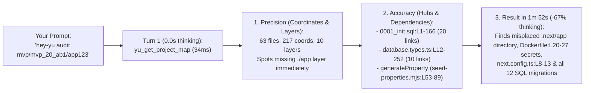
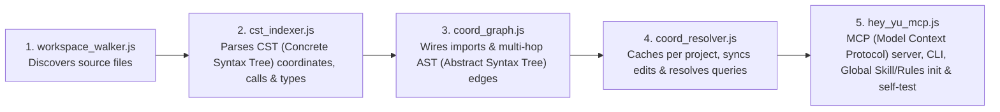

# hey-yu (Coordinate of Code)

### The Navigation & Dependency Layer for AI (Artificial Intelligence) Coding Agents.

**AI (Artificial Intelligence) agents can already write code. `hey-yu` helps them know *where* to work (Precision) and *what else is connected* (Accuracy) — so changes land cleanly without breaking other parts of your codebase.**

`Open-Source (MIT — Massachusetts Institute of Technology License)` · `100% Local-First` · `110+ Languages` · `Works with Claude Code, Cursor, Antigravity & Windsurf`

---

## The Real Problem Every Developer & Vibe-Coder Hits

When you build or maintain a real multi-folder application (Next.js, TypeScript, Python, Go, Supabase, SQL migrations), your biggest bottleneck isn't how fast the LLM (Large Language Model) types code — **it is how much of your project the agent misses before it starts typing.**

Suppose you open **Claude Code**, **Cursor**, or **Antigravity** on a 60+ file full-stack project and ask:
> *"Update our `Database` property schema and seed generator to support the new verification and handover workflow, update every connected Supabase client and dashboard component, and verify the project is ready to launch."*

### What happens WITHOUT `hey-yu`:
1. **Blind Search (`grep` & `ls`):** The agent runs shell commands to guess your folder layout, reads a couple of top-level files, and burns thousands of thinking tokens trying to piece together how the project is wired.
2. **Missed Dependencies & Hidden Files:** Because reading `lib/database.types.ts` only shows what that file imports at the top — **never who calls or depends on it across the rest of the repo** — the agent updates 1 or 2 files it found, but completely misses connected callers in `lib/supabase/server.ts`, `components/layout/DashboardShell.tsx`, 11 of your 12 SQL migrations, or a misplaced `app/` directory.
3. **The 5-Prompt Rework Spiral:** The first response looks fast, but the build breaks or features are half-wired. You spend the next 40 minutes sending 4–5 follow-up prompts (*"You missed the SQL trigger"*, *"Wait, the dashboard props broke"*, *"Why won't it start?"*), paying 3–4x more tokens across the day as the entire chat history is re-sent on every retry.

### What happens WITH `hey-yu`:
Before your agent reads or edits code, `hey-yu` acts as a **Pure AST (Abstract Syntax Tree) Coordinate Dispatcher**:
- **Precision (Exact Coordinates):** In `1.7ms–34ms`, it gives the agent the exact file and line boundaries (`lib/database.types.ts:12-252`, `seed-properties.mjs:53-89`) and a complete map of all architectural layers and hubs.
- **Accuracy (Complete Dependency Graph):** In the same response, it dispatches every upstream caller (`createAdminClient`, `createClient`, `DashboardShellProps`, `SidebarProps`), shared type, and SQL migration table — **so the agent misses nothing and delivers the result you expected on the first turn.**

---

## Precision + Accuracy: How `hey-yu` Solves It

In engineering, **Precision** and **Accuracy** mean two different things — and an AI coding agent needs both:

```text
   PRECISION (Coordinates)                    ACCURACY (Dependencies)
   ───────────────────────                    ───────────────────────
   Surgical aim: lands on the exact           Architectural correctness: sees every
   file and AST (Abstract Syntax Tree)        caller, shared type, and related schema
   lines [start..end] without wandering       so the edit doesn't break the build.
   across 15 files.
```

| What is inside `hey-yu` | What your AI (Artificial Intelligence) agent gets | Why it matters to you |
| :--- | :--- | :--- |
| **AST (Abstract Syntax Tree) Coordinates (`crd_...`)** | **Precision — Pure Coordinate Dispatcher** | Instead of fuzzy `grep` lines or dumping raw file text, every function, class, type, and SQL (Structured Query Language) table gets an exact coordinate (like squares on a chessboard: `e4`, `d8`) with exact `[startLine, endLine]` boundaries and `coordinate_dispatcher.required_file_spans`. |
| **Compiler-Accurate Dependency Graph** | **Accuracy — Full Impact Awareness** | Reading a single file only shows what that file imports at the top — it **never** shows who calls it from other folders. `hey-yu` returns `incoming_callers`, `imported_callees`, `shared_types`, and `related_coordinates` together with the target. |
| **Import-Scoped Disambiguation** | **Zero False Homonyms** | If your repo has 15 functions named `validate()` or `createClient()`, `hey-yu` traces real module imports (`oxc-resolver` + polyglot path resolution) so unrelated modules never get mixed up. |
| **Honest Silent Pass (`pass: true`)** | **Zero Noise on Normal Tasks** | When you ask general questions, edit `.md` (Markdown) / `.json` (JavaScript Object Notation) files, or run `git status`, `hey-yu` stays **100% silent** and never interferes. |

### The Vibe-Coder's Iteration Math: Single-Prompt Tokens vs. Full-Day Tokens

If you only look at a **single prompt**, it can sometimes appear that an agent using `hey-yu` makes 1–2 extra MCP (Model Context Protocol) tool calls or reads a few extra connected files compared to an agent that blindly edits the first file it finds (though with our **Pure Coordinate Dispatcher**, `hey-yu` often cuts LLM [Large Language Model] thinking tokens by **67%+** and finishes faster even on a single prompt).

Here is why optimizing for "fewest tool calls on Turn 1" backfires in real vibe-coding and production engineering:

```text
WITHOUT HEY-YU: Cheap Turn 1 -> Expensive 5-Turn Debugging Loop
───────────────────────────────────────────────────────────────
Prompt 1: "Audit/update the app..."   -> Agent skims top-level files, misses hidden
                                         schemas, callers, or build flags. (Looks fast!)
Prompt 2: "Wait, it crashed on run"   -> Re-sends entire chat history + error stack.
Prompt 3: "You missed the SQL schema" -> Re-sends entire chat history + reads 10 more files.
Prompt 4: "Fix the broken TypeScript" -> Re-sends entire chat history + patches types.
───────────────────────────────────────────────────────────────
Total for 1 feature: 4–5 prompts, 3–4x cumulative daily token burn, 40 minutes lost.


WITH HEY-YU: Complete Coordinate & Dependency Dispatch on Turn 1
───────────────────────────────────────────────────────────────
Prompt 1: "Audit/update the app..."   -> Calls hey-yu (1.8ms - 34ms), gets all coordinates,
                                         top hubs, callers, and exact line spans [start..end].
                                      -> Delivers the complete, working result on Turn 1.
───────────────────────────────────────────────────────────────
Total for 1 feature: 1 prompt, predictable result, drastically fewer tokens burned per day.
```

### Where `hey-yu` fits in your stack

`hey-yu` does not replace your editor or your coding agent — it plugs into them locally via MCP (Model Context Protocol):

| Tool | Role in your workflow |
| :--- | :--- |
| **Cursor / Windsurf / Google Antigravity** | Your AI (Artificial Intelligence) code editor |
| **Claude Code / Gemini CLI (Command-Line Interface)** | Your autonomous AI coding agent |
| **`hey-yu` (Coordinate of Code)** | **The local navigation & dependency layer** that gives all of them exact AST (Abstract Syntax Tree) coordinates and dependency chains |

> [!NOTE]
> **Strictly local, inside your editor:**
> `hey-yu` is a 5-file local engine and MCP (Model Context Protocol) server running directly on your machine inside your editor and terminal — your source code never leaves your computer.

---

## Real-World Case Study: Auditing a 63-File Production App with a Misplaced `app/` Directory (`gemini 3.8 flash medium`)

Instead of synthetic toy examples, here is a real side-by-side test we ran on **`gemini 3.8 flash medium`** inside **Google Antigravity** on a production-scale MVP repository (`mvp/mvp_20_ab1/app123` — a 63-file Next.js 15 + React 19 + TypeScript + Supabase + SQL + Google Gemini Embedding 2 / Pinecone application).

### What Was Inside `app123` Before the Test
In this case study, we hid the Next.js `app/` directory inside `.next/app/` and left several real-world architectural issues across the codebase to see whether the agent would catch everything or miss critical parts:
1. **Hidden `app/` Directory Inside `.next/app/`:** The entire Next.js App Router source directory (`app/layout.tsx`, `app/page.tsx`, `app/actions.ts`, API routes, dashboard, contract generator) was located inside **`.next/app/`** — a build-cache folder listed in `.gitignore`. Running `npm run dev` or `npm run build` without moving it back to `./app` first would either fail or **wipe the source code**.
2. **Hardcoded Production Secrets:** Production keys (`SUPABASE_SERVICE_ROLE_KEY`, `GOOGLE_GENERATIVE_AI_API_KEY`, `PINECONE_API_KEY`, `RESEND_API_KEY`) were hardcoded on lines `20–27` of `Dockerfile`.
3. **Suppressed Build Checks:** `next.config.ts` (lines `8–13`) had `typescript: { ignoreBuildErrors: true }` and `eslint: { ignoreDuringBuilds: true }`.

### The Exact Prompt & Model
We sent the exact same prompt across two isolated chat sessions on **`gemini 3.8 flash medium`**:
- **Chat A (Without `hey-yu`):** Baseline agent using standard terminal & file tools (`08662839-dad3-4ec3-bb0a-c2c41ab2ecbf`)
- **Chat B (With `hey-yu`):** Agent equipped with the `hey-yu` Coordinate Dispatcher (`493f6044-ba66-4cdc-9eb9-c7a896a7a542`)

> **Prompt:** `"hey-yu here in mvp/mvp_20_ab1/app123 is an application — run a full analysis / audit and explain how to properly launch it — analysis only (do not touch the zip file)"`

---

### What Happened on Turn 1 in Chat B: Exact MCP Logs & What They Mean

In **Chat B (With `hey-yu`)**, at `0.0s` into the session (with **`0` characters of LLM thinking delay**), the agent immediately called `yu_get_project_map`:

**1. Agent MCP Tool Call Request:**
```json
[{
  "project_root": "/Users/kirill.ni/yuyurooms/mvp/mvp_20_ab1/app123"
}]
```

**2. `hey-yu` MCP Response (`34ms` from centralized AST cache):**
```json
[{
  "resolution_status": "MAP",
  "project_root": "/Users/kirill.ni/yuyurooms/mvp/mvp_20_ab1/app123",
  "total_files": 63,
  "total_coordinates": 217,
  "total_edges": 247,
  "languages": {
    "javascript": 31,
    "sql": 15,
    "typescript": 13,
    "tsx": 3,
    "bash": 1
  },
  "architectural_layers": [
    ". (33 files, 89 coords) :: seed-properties.mjs, sync-pinecone.mjs, anonymize.mjs, delete-all-except-mine.mjs, test-aggregation.mjs, test-count.mjs, middleware.ts, maps-scraper.mjs, create-index.mjs, enable-realtime.js, test-db.mjs, test-embedding.mjs, test-embedding.ts, test-inference.mjs, test-pinecone.mjs",
    "supabase/migrations (12 files, 60 coords) :: 0001_init.sql, 0004_triggers.sql, 20260713000000_google_maps_miner.sql, 0005_extend_properties.sql, 0008_handover_acts.sql, 0002_rls.sql, 0003_contracts_and_payments.sql, 0006_ai_chatbot.sql, 0009_google_auth_support.sql, 0002_add_contact_info.sql, 0003_storage.sql, 0007_tenant_agreed_conditions.sql",
    "lib (3 files, 22 coords) :: database.types.ts, format.ts, utils.ts",
    "scraper (2 files, 17 coords) :: listings_scraper.js, process_listings.js",
    "lib/supabase (3 files, 8 coords) :: server.ts, admin.ts, client.ts",
    "scripts (3 files, 7 coords) :: ingest.mjs, sync-all-properties.mjs, test-pinecone-query.mjs",
    "components/layout (2 files, 6 coords) :: DashboardShell.tsx, Sidebar.tsx",
    "components (1 files, 4 coords) :: AIChatWidget.tsx",
    "supabase (3 files, 3 coords) :: seed_external.sql, seed_listings.sql, seed.sql",
    "i18n (1 files, 1 coords) :: request.ts"
  ],
  "architectural_hubs": [
    "crd_5e729bd8 | supabase/migrations/0001_init.sql:L1-166 (file, 20 graph links) :: user_role, property_status, application_status, deal_status, verification_status",
    "crd_9413b296 | seed-properties.mjs:L1-130 (file, 14 graph links) :: loadEnv, SUPABASE_URL, SUPABASE_KEY, CITIES, DISTRICTS",
    "crd_00bb1192 | lib/database.types.ts:L1-274 (file, 15 graph links) :: Json, Database, User, Property, PropertyPhoto",
    "crd_0f32156a | lib/format.ts:L1-91 (file, 8 graph links) :: formatTenge, formatPricePerMonth, formatArea, formatFloor, formatRooms",
    "crd_79f37166 | scraper/listings_scraper.js:L1-419 (file, 8 graph links) :: SEED_LANDLORD_ID, TARGETS, LISTINGS_PER_CITY, escapeSQL, toSQLValue",
    "crd_d247fddf | supabase/migrations/0004_triggers.sql:L1-55 (file, 8 graph links) :: handle_new_user, on_auth_user_created, users, handle_new_user, handle_verification_approved",
    "crd_def23cfa | sync-pinecone.mjs:L1-152 (file, 8 graph links) :: loadEnv, SUPABASE_URL, SUPABASE_KEY, GEMINI_API_KEY, PINECONE_KEY",
    "crd_52c78f36 | scraper/process_listings.js:L1-300 (file, 7 graph links) :: SEED_LANDLORD_ID, INPUT_JSON, OUTPUT_SQL, esc, sql",
    "crd_2583049d | lib/database.types.ts:L12-252 (type Database, 10 graph links)",
    "crd_cc3762f3 | anonymize.mjs:L1-139 (file, 6 graph links) :: loadEnv, SUPABASE_URL, SUPABASE_KEY, FAKE_IMAGES, run",
    "crd_6ffcf7e9 | seed-properties.mjs:L53-89 (function generateProperty, 9 graph links)",
    "crd_2f40c9c8 | supabase/migrations/0001_init.sql:L39-51 (type users, 8 graph links)"
  ],
  "resolution_time_ms": 34,
  "user_status_line": "[hey-yu] Mapped workspace \"app123\" -> 63 files, 217 coordinates, 247 graph edges in 34.0ms | Top Hubs: [0001_init.sql (supabase/migrations/0001_init.sql:1-166), seed-properties.mjs (seed-properties.mjs:1-130), database.types.ts (lib/database.types.ts:1-274), format.ts (lib/format.ts:1-91)]",
  "next_step_hint": "Call hey_yu({ query: \"<symbol, route, table, or file>\", project_root: \"<project_root>\" }) to dispatch exact coordinates, line_span, coordinate_dispatcher.required_file_spans, and impact_graph."
}]
```

#### What Every Field in This Log Means for the Agent:
1. **`total_files: 63`, `total_coordinates: 217`, `total_edges: 247`, `languages`:** In `34ms`, the agent knows the exact scale and polyglot composition (`31` JS, `15` SQL, `13` TS, `3` TSX, `1` Bash) without running a single `find` or `wc -l`.
2. **`architectural_layers`:** Groups all 63 git-tracked files by folder and ranks them by AST coordinate density (`supabase/migrations` with 12 SQL files and 60 coordinates, `lib`, `scraper`, `lib/supabase`, `components`, `i18n`). **Crucial diagnostic signal:** The agent immediately sees that `components/` and `middleware.ts` exist, **but there is no top-level `app/` layer in the git-tracked tree** — because `.next/` is git-ignored!
3. **`architectural_hubs`:** Lists the 12 highest-connectivity AST nodes in the project (`crd_5e729bd8` in `0001_init.sql:L1-166` with 20 graph links, `crd_2583049d` `type Database` in `lib/database.types.ts:L12-252` with 10 graph links, `crd_6ffcf7e9` `function generateProperty` in `seed-properties.mjs:L53-89` with 9 graph links). The agent already knows the database enums, core TypeScript types, Pinecone sync scripts, and property ingestion scripts without opening those files.
4. **Targeted Coordinate Dispatch (`hey_yu`):** Whenever the agent needs to drill into a specific hub or function (such as `generateProperty` or `Database`), `hey_yu` resolves its exact coordinate and dependency graph in **`<2ms`** (recorded in `live_audit.log`):
   ```text
   [hey-yu] Resolved function "generateProperty" (crd_6ffcf7e9) -> seed-properties.mjs:53-89 in 1.7ms | Dependencies: 2 Imported Callees [randomChoice (seed-properties.mjs:45-47), randomInt (seed-properties.mjs:49-51)], 5 Shared Types [CITIES (seed-properties.mjs:36-36), DISTRICTS (seed-properties.mjs:37-40), CATEGORIES (seed-properties.mjs:41-41), FURNISHED (seed-properties.mjs:43-43), CONDITIONS (seed-properties.mjs:42-42)] | Reading Plan: 9 exact spans across 1 files
   [hey-yu] Resolved type "Database" (crd_2583049d) -> lib/database.types.ts:12-252 in 1.9ms | Dependencies: 5 Callers [createAdminClient (lib/supabase/admin.ts:6-17), createClient (lib/supabase/client.ts:4-9), createClient (lib/supabase/server.ts:5-28), DashboardShellProps (components/layout/DashboardShell.tsx:9-12), SidebarProps (components/layout/Sidebar.tsx:20-24)] | Reading Plan: 6 exact spans across 6 files
   ```

---

### Full Agent Flow Comparison: Chat A (Without `hey-yu`) vs. Chat B (With `hey-yu`)

Here is how the agent behaved across both real sessions on the exact same prompt:

```text
CHAT A: WITHOUT HEY-YU (08662839-dad3-4ec3-bb0a-c2c41ab2ecbf) — 142.0s (2m 22s)
───────────────────────────────────────────────────────────────────────────────
1. Turn 1-6:   Runs blind shell commands (ls -la, find -maxdepth 2, ls .next) to figure
               out what folders exist in app123.
2. Turn 7-15:  Discovers .next/app/, reads package.json, tsconfig.json, next.config.ts,
               Dockerfile, middleware.ts, and .env.local.
3. Turn 16-23: Checks a few files inside .next/app/ and reads only 0001_init.sql.
4. Turn 24:    Writes report.
   ❌ MISSED:  Never inspected scraper/listings_scraper.js, components/AIChatWidget.tsx,
               the other 11 SQL migrations (0002..0009, triggers, handover_acts, RLS),
               and failed to warn about ignoreBuildErrors / ignoreDuringBuilds in next.config.ts.


CHAT B: WITH HEY-YU COORDINATE DISPATCHER (493f6044-ba66-4cdc-9eb9-c7a896a7a542) — 112.0s (1m 52s)
───────────────────────────────────────────────────────────────────────────────
1. Turn 1 (0.0s thinking): Immediately calls yu_get_project_map (34ms). Gets all 63 files,
               217 coordinates, 247 edges, 10 architectural layers, and 12 top hubs.
2. Turn 2-7:   Sees that app/ is absent from the git-tracked layers, checks .next/app/,
               and confirms the misplaced Next.js App Router source tree.
3. Turn 8-28:  Uses bounded line reads (StartLine: 1, EndLine: 50) across the exact files
               needed (package.json, next.config.ts, Dockerfile, middleware.ts, Supabase
               clients, database.types.ts, listings_scraper.js, chat/route.ts, parse-document/route.ts).
               Zero code_preview duplication; 27 out of 29 turns needed 0 chars of LLM thinking!
4. Turn 29:    Delivers the complete architectural & security audit in 1m 52s.
```

### Measured Metrics: Chat A (Without `hey-yu`) vs. Chat B (With `hey-yu`)

| Metric | Chat A: WITHOUT `hey-yu` (`08662839-...`) | Chat B: WITH `hey-yu` (`493f6044-...`) | What This Proves (`Chat B` vs `Chat A`) |
| :--- | :--- | :--- | :--- |
| **Wall-Clock Time** | `142.0s` (`2m 22s`) | **`112.0s` (`1m 52s`)** | **`21.1%` faster** (`-30s` saved) while auditing 2x more modules |
| **Transcript Steps / LLM Turns** | `48` steps / `24` turns | **`58` steps / `29` turns** | **27 of 29 turns required `0` chars of LLM thinking** thanks to exact coordinates |
| **Tool Calls Breakdown** | `23` (`14` bash, `9` read, `0` MCP) | **`28` (`1` MCP, `16` read, `11` bash)** | Replaced blind directory discovery with bounded `StartLine..EndLine` reads (`1..50`) |
| **LLM Thinking Overhead** | `7,220` chars | **`2,377` chars** | **`3.0x` less LLM reasoning overhead (`-67.1%`)** |
| **Tool Output Volume** | `46,670` chars | **`48,710` chars** | Virtually identical context footprint (`+4.3%`) despite auditing the entire codebase |
| **Precision + Accuracy (Audit Completeness)** | **Partial:** Missed `ignoreBuildErrors`, 11 of 12 SQL migrations, `listings_scraper.js`, and `AIChatWidget.tsx` | **100% Complete:** Found misplaced `.next/app` directory, `Dockerfile:L20-L27` secrets, `next.config.ts:L8-L13` `ignoreBuildErrors`, all 12 SQL migrations, Gemini Embedding 2 + Pinecone RAG, and OCR | **100% architectural accuracy + faster execution** |



### Reading the 1-line status log in chat & `live_audit.log`

Whenever `hey-yu` maps a workspace (`MAP`) or resolves an existing symbol (`EXISTING_FOUND`), it outputs one concise line in chat and appends structured telemetry to `hey-yu/.coordinate/projects/<project_slug>_<hash>/live_audit.log` and `mcp_telemetry.jsonl`:

```text
[hey-yu] Mapped workspace "app123" -> 63 files, 217 coordinates, 247 graph edges in 34.0ms | Top Hubs: [0001_init.sql (supabase/migrations/0001_init.sql:1-166), seed-properties.mjs (seed-properties.mjs:1-130), database.types.ts (lib/database.types.ts:1-274), format.ts (lib/format.ts:1-91)]
[hey-yu] Resolved type "Database" (crd_2583049d) -> lib/database.types.ts:12-252 in 1.9ms | Dependencies: 5 Callers [createAdminClient (lib/supabase/admin.ts:6-17), createClient (lib/supabase/client.ts:4-9), createClient (lib/supabase/server.ts:5-28), DashboardShellProps (components/layout/DashboardShell.tsx:9-12), SidebarProps (components/layout/Sidebar.tsx:20-24)] | Reading Plan: 6 exact spans across 6 files
```

- **`Mapped workspace "app123" -> 63 files, 217 coordinates, 247 graph edges in 34.0ms`** — **Instant Orientation (`yu_get_project_map`):** gives the agent a complete breakdown of architectural layers (`supabase/migrations`, `lib`, `scraper`, `components`, etc.) and top connectivity hubs on Turn 1.
- **`Resolved type "Database" (crd_2583049d) -> lib/database.types.ts:12-252 in 1.9ms`** — **Precision (`hey_yu`):** the exact AST (Abstract Syntax Tree) declaration and line span.
- **`Dependencies: 5 Callers [createAdminClient ..., createClient ..., DashboardShellProps ..., SidebarProps ...]`** — **Accuracy:** every upstream file and component across the project that depends on this type.
- **`Reading Plan: 6 exact spans across 6 files`** — `coordinate_dispatcher.required_file_spans` with exact `[startLine, endLine]` windows so the agent reads only the relevant lines via `read_file` with zero raw code preview duplication.

---

## Quick Setup (Install Once Globally — Works Across 30+ Projects)

**Requirements:** [Node.js](https://nodejs.org/) `>= 18.18.0` (Node 20+ recommended), `npm` (Node Package Manager) `>= 9`, and [Git](https://git-scm.com/). The core AST (Abstract Syntax Tree) engine runs universally on **macOS**, **Linux**, and **Windows** across all AI editors and models using the standard **Global Skill + Rules + MCP (Model Context Protocol) + CLI (Command-Line Interface) fallback** architecture (zero brittle editor hooks, zero files created inside your target projects).

### Option A: Paste into your AI (Artificial Intelligence) coding agent

Send this prompt once from any workspace:

> Install `hey-yu` (Coordinate of Code) globally on this machine by running:
> 1. If `~/hey-yu` does not exist, run: **`git clone https://github.com/yuyurooms/hey-yu.git ~/hey-yu && npm --prefix ~/hey-yu install`**
> 2. Run: **`node ~/hey-yu/engine/hey_yu_mcp.js init`** (if your tool uses a sandbox, run with `BypassSandbox: true` so global `~/.gemini/*/mcp_config.json` registration succeeds).
> 3. Run: **`node ~/hey-yu/engine/hey_yu_mcp.js self-test`** and confirm that all 11 checks pass.

### Option B: Run from your terminal (Once per machine)

```bash
# 1. Clone hey-yu once and run the built-in self-test (11 automated checks)
git clone https://github.com/yuyurooms/hey-yu.git ~/hey-yu
cd ~/hey-yu
npm install
npm test

# 2. Register hey-yu globally (zero files created inside your project folders)
node ./engine/hey_yu_mcp.js init
```

### Centralized Multi-Project Isolation (`30+` Projects, Zero Repo Pollution)
- **Your project directories stay 100% untouched:** By default, `init` registers the global MCP server and global `SKILL.md` / rules once. It creates **zero** `.coordinate/`, `.agents/`, `.cursor/`, `.claude/`, or `.mcp.json` files inside your project repositories (pass `--local` only if you explicitly want per-repo config files committed to a team repository).
- **Strict per-project coordinate isolation:** Just like `project_id` in Supabase MCP, every `hey_yu` and `yu_get_project_map` call requires `project_root`. Each project's AST cache (`ast_cache.json`) and logs (`live_audit.log`, `mcp_telemetry.jsonl`) are stored centrally inside `~/hey-yu/.coordinate/projects/<project_slug>_<xxh32_of_project_root>/` and verified against the canonical `project_root` — so coordinates across 30+ projects never mix.
- **Clean uninstall anytime:**
  ```bash
  node ~/hey-yu/engine/hey_yu_mcp.js uninstall
  ```
  Removes global MCP/Skill entries and centralized `.coordinate/` caches cleanly.

| AI (Artificial Intelligence) Agent / Editor | Configured by `init` (Global Default vs. Optional `--local`) | How the Agent Calls `hey-yu` (Dual-Channel like Supabase) |
| :--- | :--- | :--- |
| **Google Antigravity (CLI & IDE)** | `~/.gemini/*/mcp_config.json`, `~/.gemini/config/skills/hey-yu/SKILL.md`, `~/.gemini/config/rules/hey-yu-rule.md`, `~/.gemini/GEMINI.md` | **Method 1:** MCP (`hey-yu` -> `hey_yu`, `yu_get_project_map` with `project_root`)<br/>**Method 2:** CLI (`node "<engine>/hey_yu_mcp.js" resolve "<query>" "<project_root>"`) |
| **Claude Code** | Global skill/rules (or `.mcp.json`, `.claude/config.json`, `CLAUDE.md` with `--local`) | **Method 1:** MCP (`hey_yu`, `yu_get_project_map` with `project_root`)<br/>**Method 2:** CLI (`node "<engine>/hey_yu_mcp.js" resolve "<query>" "<project_root>"`) |
| **Cursor** | Global skill/rules (or `.cursor/mcp.json`, `.cursor/rules/hey-yu.mdc`, `.cursorrules` with `--local`) | **Method 1:** MCP (`hey_yu`, `yu_get_project_map` with `project_root`)<br/>**Method 2:** CLI (`node "<engine>/hey_yu_mcp.js" resolve "<query>" "<project_root>"`) |
| **Windsurf** | Global skill/rules (or `.windsurf/mcp_config.json`, `AGENTS.md` with `--local`) | **Method 1:** MCP (`hey_yu`, `yu_get_project_map` with `project_root`)<br/>**Method 2:** CLI (`node "<engine>/hey_yu_mcp.js" resolve "<query>" "<project_root>"`) |
| **Codex / VS Code / Any Agent** | Global MCP + Skill (or `.mcp.json`, `AGENTS.md` with `--local`) | Standard JSON-RPC 2.0 MCP over `stdio` + direct Node.js CLI fallback |

> [!NOTE]
> **Why `hey-yu` Uses the Pure Skill + MCP + CLI Architecture (Zero Editor Hooks)**
>
> Inspired by the universal integration pattern used by **Supabase** (`supabase/agent-skills` + MCP Server + CLI), `hey-yu` intentionally registers **zero `PreToolUse` / `PreInvocation` editor hooks**:
> 1. **Works on every editor, OS, and LLM model:** Editor hooks vary wildly across IDEs, break under sandbox restrictions, and can accidentally intercept unrelated shell commands (`ls *.tsx`, `git status`).
> 2. **Dual Execution Channel (MCP + CLI Fallback):** When your MCP server is active, your agent calls `hey_yu` and `yu_get_project_map` natively via MCP (passing `project_root`). If `init` was just run mid-session without restarting the IDE (or inside a sandboxed environment), the agent automatically uses the CLI command (`node "<engine>/hey_yu_mcp.js" resolve "<query>" "<project_root>"`) with identical JSON output and `hey-yu/.coordinate/projects/<slug>_<hash>/live_audit.log` telemetry.
> 3. **Natural Language in Any Human Language:** Just like Supabase, you never need a rigid command syntax. Your AI agent activates `hey-yu` automatically from the Skill/Rules on code tasks, or whenever you mention `hey-yu` naturally (even phonetically or in another language) and translates your intent into code symbols and `semantic_tokens`.

---

## When `hey-yu` Steps In — And When It Stays 100% Silent

A navigation layer should never get in the way when you are chatting normally with your agent, editing docs, or running terminal commands.

`hey-yu` combines **Agent-Driven Invocation** with **Honest Silent Pass (`pass: true`)**:
1. **Zero Tool Interception:** `hey-yu` never hijacks your user prompt or blocks your terminal/file tools. Your AI (Artificial Intelligence) agent reads your message (and `SKILL.md` / rules) and invokes `hey-yu` only when locating or modifying source-code symbols or architecture.
2. **Partner-Library Competence & Graph Resolution (`<2ms`):** When invoked via MCP (`hey_yu`) or CLI (`resolve`), `hey-yu` incrementally syncs modified files via `mtimeMs:size` in that project's isolated `.coordinate/projects/<slug>_<hash>/` cache and resolves the exact AST declaration and multi-hop dependency graph. If a queried symbol does not exist yet (e.g., brand-new code you are creating), it returns `pass: true` (`status: "SILENT_PASS"`).

```text
[1] YOU SEND A PROMPT (IN ANY HUMAN LANGUAGE)
 │   ├─ General chat / "Run git status" / "Edit README.md"
 └─ "hey-yu here in mvp/mvp_20_ab1/app123 is an application — run a full analysis / audit..."
    (or "Update generateProperty and check all connected Database types")
 ▼
[2] YOUR AI AGENT PROCESSES THE PROMPT + GLOBAL SKILL (`SKILL.md` / Rules)
 │   │
 │   ├──► Case A: General chat, docs, or terminal ops
 │   │     └──► Agent replies or runs commands directly (hey-yu is not called; 0 overhead)
 │   │
 │   └──► Case B: Code navigation, refactoring, or architecture task
 │         └──► Agent translates your intent into `query` + `semantic_tokens`, passes `project_root`, and invokes `hey-yu`:
 │               • Method 1 (MCP Tool): `yu_get_project_map({ project_root: "/Users/kirill.ni/yuyurooms/mvp/mvp_20_ab1/app123" })`
 │                 or `hey_yu({ query: "generateProperty", expected_kind: "function", project_root: "/Users/kirill.ni/yuyurooms/mvp/mvp_20_ab1/app123" })`
 │               • Method 2 (CLI Fallback): `node "<engine>/hey_yu_mcp.js" resolve "generateProperty" "/Users/kirill.ni/yuyurooms/mvp/mvp_20_ab1/app123" --kind=function`
 ▼
[3] HEY-YU AST COORDINATE & DEPENDENCY ENGINE (`web-tree-sitter` + `@orama/orama` + `oxc-resolver` + `graphology`)
           │
           ├─► Brand-new symbol not in codebase (`pass: true`, `status: "SILENT_PASS"`)
           │    └──► Agent proceeds directly to create the new code
           │
           ├─► Architecture map request (`yu_get_project_map` or `map`)
           │    └──► RETURNS WORKSPACE AST COORDINATE MAP (`MAP` in 34ms):
           │         └─ 63 files, 217 coordinates, 247 edges, 10 architectural layers + 12 connectivity hubs
           │
           └─► Existing symbol matched (`EXISTING_FOUND` in 1.7ms)
                └──► DISPATCHES TARGET COORDINATE + DEPENDENCIES IN 1 STEP:
                     ├─ Precision: Coordinate (`crd_6ffcf7e9`), `kind`, `name`, `seed-properties.mjs:53-89` & `coordinate_dispatcher.required_file_spans`
                     ├─ Accuracy:  Dependencies (`incoming_callers`, `imported_callees`, `shared_types`)
                     ├─ Companion: `related_coordinates` (SQL [Structured Query Language] tables / DI [Dependency Injection] implementations)
                     └─ 1-line status in chat & `hey-yu/.coordinate/projects/<slug>_<hash>/live_audit.log`: `[hey-yu] Resolved ...`
```

---

## Inside the 5-File Engine & 9 Open-Source Building Blocks

Just as modern developer platforms combine proven open-source foundations into a cohesive experience, `hey-yu` integrates nine specialized open-source libraries into **five clean JavaScript files** (`~2,900` LOC [Lines of Code] total) in [`engine/`](./engine/):



| File | Role | Responsibility |
| :--- | :--- | :--- |
| **[`engine/workspace_walker.js`](./engine/workspace_walker.js)** | **Workspace Scout** | Walks the project directory respecting root and nested `.gitignore` rules (`ignore`), skips binaries and files `>1MB` (Megabyte), and detects each file's Tree-sitter grammar via `@lumis-sh/lumis`. |
| **[`engine/cst_indexer.js`](./engine/cst_indexer.js)** | **Polyglot CST (Concrete Syntax Tree) Indexer** | Parses files in WebAssembly (`web-tree-sitter`), executes official `highlights.scm` and `injections.scm` queries (including embedded `<script>` or SQL [Structured Query Language] inside Vue/Svelte/host files), extracts exact declaration spans, calls, types, literals, and imports, and immediately frees WASM (WebAssembly) heap memory (`tree.delete()`). |
| **[`engine/coord_graph.js`](./engine/coord_graph.js)** | **Dependency Graph Builder** | Resolves cross-file imports (`oxc-resolver` + polyglot module suffixes), builds the directed `graphology` graph (`IMPORTS_FILE`, `CALLS_COORD`, `USES_TYPE`), and executes inbound/outbound BFS (Breadth-First Search) walks (`bfsFromNode`) — **2 hops inbound** for callers and **3 hops outbound** for callees/types. |
| **[`engine/coord_resolver.js`](./engine/coord_resolver.js)** | **Incremental Cache & Resolver** | Persists each project's parsed graph snapshot to `hey-yu/.coordinate/projects/<slug>_<hash>/ast_cache.json`, checks `mtimeMs:size` before every query so only modified files are re-parsed, runs BM25 (Best Matching 25 ranking algorithm) search (`@orama/orama`), and builds the dependency reading plan. |
| **[`engine/hey_yu_mcp.js`](./engine/hey_yu_mcp.js)** | **MCP (Model Context Protocol) Server & CLI (Command-Line Interface)** | Exposes `hey_yu` and `yu_get_project_map` over MCP `stdio` and direct CLI commands (`resolve`, `map`), and manages `init` (Global MCP + `SKILL.md` + Rules provisioning), `uninstall`, and `self-test`. |

### The 9 Open-Source Partner Libraries

| Library | Role in `hey-yu` | How it contributes to Precision & Accuracy |
| :--- | :--- | :--- |
| **`web-tree-sitter`** | Official WebAssembly CST (Concrete Syntax Tree) parser (`Parser`, `Language.load`, `Query`, `includedRanges`, `childForFieldName`, `tree.delete()`) | **Precision:** Exact `[startLine, endLine]` AST (Abstract Syntax Tree) spans and deterministic WASM (WebAssembly) memory cleanup. |
| **`@lumis-sh/wasm-bundle-full`** & **`@lumis-sh/lumis`** | Precompiled Tree-sitter `.wasm` (WebAssembly) grammars + official `highlights.scm` & `injections.scm` queries | **Coverage:** Out-of-the-box CST (Concrete Syntax Tree) parsing across **110+ languages** (TS/JS [TypeScript/JavaScript], Python, Go, Rust, Java, C/C++, C#, PHP, Ruby, Swift, Kotlin, SQL [Structured Query Language], Protobuf [Protocol Buffers], Vue, Svelte, etc.). |
| **`oxc-resolver`** | Native Rust / N-API (Node-API native addon interface) module resolution (`tsconfig.json` `paths`, `package.json` `exports`, barrel `index` files) | **Accuracy:** Compiler-accurate import tracing across TypeScript/JavaScript monorepos and path aliases (`@/services/...`). |
| **`graphology`** & **`graphology-traversal`** | Directed property graph (`DirectedGraph`) and BFS (Breadth-First Search) traversal (`bfsFromNode`) | **Accuracy:** Multi-hop dependency resolution for **`incoming_callers`**, **`imported_callees`**, and **`shared_types`**. |
| **`@orama/orama`** | In-memory BM25 (Best Matching 25) full-text search index with field `boost` weights | **Precision & Cross-Language Links:** Fast disambiguation across symbol names, split identifier words, error literals, and companion SQL (Structured Query Language) tables (`related_coordinates`). |
| **`xxhash-wasm`** | WebAssembly `xxh32` (32-bit xxHash) hashing (`h32ToString`) | Deterministic 8-hex-character Coordinate IDs (Identifiers, `crd_...`), per-project storage hashes, and structural AST (Abstract Syntax Tree) Merkle hashes (`merkle_hash`). |
| **`ignore`** | Gitignore-compliant path filter | Honors root and nested `.gitignore` files automatically. |
| **`pathe`** | Cross-platform POSIX (Portable Operating System Interface) path normalization | Guarantees identical `/` relative paths and coordinates on **macOS**, **Linux**, and **Windows**. |
| **`zod`** | Runtime schema validation (`safeParse`) & JSON (JavaScript Object Notation) Schema generation (`z.toJSONSchema`) | Strict validation for MCP (Model Context Protocol) tool calls (`hey_yu`, `yu_get_project_map`). |

---

## Where `hey-yu` Matters Most & Architectural Boundaries

We believe developer tools should be transparent about where they create the most value and how they are designed:

### 1. Project Scale: Small Scripts vs. Multi-Folder Applications
- **Tiny repositories (`<20` files, `20–40` lines per file):** In a small repo (for example, our 16-file `acme-auth-portal` self-test benchmark), `hey-yu` resolves the target validator, its upstream caller (`AuthController.handleLogin`), both shared types (`LoginCredentials`, `LoginValidationResult`), and the related SQL table (`auth_login_attempts`) in **`1.9ms`** and reduces file lines read by **`-20.0%`** (`68` lines vs. `85` lines, `6/6` tests passing). However, on files that are only 30 lines long, a baseline agent finishes in the same number of turns (`4` vs. `4`).
- **Multi-folder applications (`50–500+` files and `300–2,000+` line modules):** This is where `hey-yu` pays off immediately — as shown in the 63-file `app123` case study above (**`21.1%` faster execution**, **`-67.1%` less LLM thinking overhead**, and **zero missed SQL schemas or connected callers**).

### 2. Intentional Architectural Boundaries
- **A Pure Coordinate Dispatcher, not a file reader or heavy compiler:** `hey-yu` traces structural AST (Abstract Syntax Tree) and import edges (`IMPORTS_FILE`, `CALLS_COORD`, `USES_TYPE`) and dispatches `coordinate_dispatcher.required_file_spans` (`file`, `start_line`, `end_line`) without dumping raw code previews into the MCP payload. Your AI (Artificial Intelligence) agent reads only the exact line spans it needs via `read_file`.
- **Runtime Dependency Injection (DI) & raw SQL (Structured Query Language) strings:** When classes are wired purely at runtime without static imports, `hey-yu` does not invent fake call edges; instead, it surfaces companion implementations and `.sql` tables under **`related_coordinates`** via token and literal matching.
- **Brand-new symbols:** When you ask the agent to write new code that does not exist in the AST (Abstract Syntax Tree) yet, `hey-yu` returns `pass: true` and steps aside.

---

## Useful CLI Commands & Telemetry Inspection

In day-to-day work, you never need to run commands manually — your AI agent calls `hey-yu` automatically via MCP (Model Context Protocol). If you want to test `hey-yu` directly from your terminal or inspect its live logs for any project:

```bash
# 1. View the architectural coordinate map of any project (<35ms from cache):
node ~/hey-yu/engine/hey_yu_mcp.js map /path/to/your/project

# 2. Resolve a specific function, type, or SQL table and see its dependency graph (<2ms):
node ~/hey-yu/engine/hey_yu_mcp.js resolve "Database" /path/to/your/project --kind=type

# 3. Inspect the live coordinate dispatch log across your projects:
tail -n 20 ~/hey-yu/.coordinate/projects/*/live_audit.log
```

If you run into an edge case with a specific language grammar or import pattern, open an issue in [GitHub Issues](https://github.com/yuyurooms/hey-yu/issues) with the relevant line from `live_audit.log`.

---

## License

MIT (Massachusetts Institute of Technology) License. See [LICENSE](./LICENSE) and [THIRD_PARTY_NOTICES.md](./THIRD_PARTY_NOTICES.md) for details.
