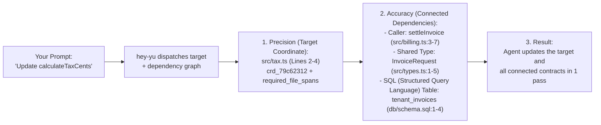
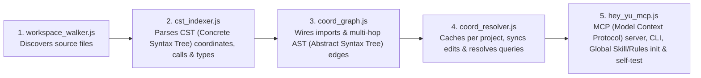

# hey-yu (Coordinate of Code)

### The Navigation & Dependency Layer for AI (Artificial Intelligence) Coding Agents.

**AI (Artificial Intelligence) agents can already write code. `hey-yu` helps them know *where* to work (Precision) and *what else is connected* (Accuracy) — so changes land cleanly without breaking other parts of your codebase.**

`Open-Source (MIT — Massachusetts Institute of Technology License)` · `100% Local-First` · `110+ Languages` · `Works with Claude Code, Cursor, Antigravity & Windsurf`

---

## The Problem Every Developer Hits with AI (Artificial Intelligence) Agents

Imagine a normal afternoon with an AI coding agent:

You ask **Claude Code**, **Cursor**, or **Antigravity**:
> *"Update the login validation, add the new error code, and make sure the rest of the auth and billing modules keep working."*

What usually happens next?
1. The agent runs text searches (`grep`), sifts through dozens of noisy matches, and tries to guess where the real logic lives.
2. It finds the function and changes the code — **but misses an important caller in another folder, a shared request interface, or a database table tied to that contract**.
3. Something that used to work is now broken, and you spend the next hour prompting the agent four or five times to track down and fix the fallout.

**The problem isn't that AI models can't write code.** The problem is that plain text search gives them no reliable way to orient themselves in an existing project or see the blast radius of a change before editing.

---

## Precision + Accuracy: How `hey-yu` Solves It

In engineering, **Precision** and **Accuracy** mean two different things — and an AI coding agent needs both:

```text
   PRECISION (Coordinates)                    ACCURACY (Dependencies)
   ───────────────────────                    ───────────────────────
   Surgical aim: lands on the exact           Architectural correctness: sees every
   file and AST (Abstract Syntax Tree)        caller, shared type, and related schema
   lines [start..end] without wandering       so the edit doesn't break the build.
   across 15 files.
```

| What is inside `hey-yu` | What your AI (Artificial Intelligence) agent gets | Why it matters to you |
| :--- | :--- | :--- |
| **AST (Abstract Syntax Tree) Coordinates (`crd_...`)** | **Precision — Pure Coordinate Dispatcher** | Instead of fuzzy `grep` lines or dumping raw file text, every function, class, type, and SQL (Structured Query Language) table gets an exact coordinate (like squares on a chessboard: `e4`, `d8`) with exact `[startLine, endLine]` boundaries and `coordinate_dispatcher.required_file_spans`. |
| **Compiler-Accurate Dependency Graph** | **Accuracy — Full Impact Awareness** | Reading `src/tax.ts` alone only shows what `src/tax.ts` imports at the top — it **never** shows who calls `src/tax.ts` from other folders. `hey-yu` returns `incoming_callers`, `imported_callees`, `shared_types`, and `related_coordinates` together with the target. |
| **Import-Scoped Disambiguation** | **Zero False Homonyms** | If your repo has 15 functions named `validate()` or `save()`, `hey-yu` traces real module imports (`oxc-resolver` + polyglot path resolution) so unrelated modules never get mixed up. |
| **Honest Silent Pass (`pass: true`)** | **Zero Noise on Normal Tasks** | When you ask general questions, edit `.md` (Markdown) / `.json` (JavaScript Object Notation) files, or run `git status`, `hey-yu` stays **100% silent** and never interferes. |

### Where `hey-yu` fits in your stack

`hey-yu` does not replace your editor or your coding agent — it plugs into them locally via MCP (Model Context Protocol):

| Tool | Role in your workflow |
| :--- | :--- |
| **Cursor / Windsurf / Google Antigravity** | Your AI (Artificial Intelligence) code editor |
| **Claude Code / Gemini CLI (Command-Line Interface)** | Your autonomous AI coding agent |
| **`hey-yu` (Coordinate of Code)** | **The local navigation & dependency layer** that gives all of them exact AST (Abstract Syntax Tree) coordinates and dependency chains |

> [!NOTE]
> **Strictly local, inside your editor:**
> `hey-yu` is a 5-file local engine and MCP (Model Context Protocol) server running directly on your machine inside your editor and terminal — your source code never leaves your computer.

---

## Without `hey-yu` vs. With `hey-yu`

Here is what happens on the exact same task when a function has connected callers and types across multiple files:

```text
WITHOUT HEY-YU (Isolated file view -> broken callers)
─────────────────────────────────────────────────────
Prompt: Update calculateTaxCents so tax exemption is supported, and make sure
        nothing in billing breaks.

Agent:  1. Runs grep for "calculateTaxCents" -> gets raw line hits across multiple files.
        2. Reads all of src/tax.ts to find where calculateTaxCents starts and ends.
        3. Updates calculateTaxCents in src/tax.ts.
        4. Stops there — because nothing inside src/tax.ts shows that settleInvoice()
           in src/billing.ts calls it with InvoiceRequest from src/types.ts.
        5. Result: Build breaks on the next run; you spend 3 more iterations pointing
           the agent to src/billing.ts and src/types.ts.


WITH HEY-YU (Target coordinate + connected dependencies on Turn 1)
──────────────────────────────────────────────────────────────────
Prompt: Update calculateTaxCents so tax exemption is supported, and make sure
        nothing in billing breaks.

Agent:  1. Calls hey_yu({ query: "calculateTaxCents", expected_kind: "function", project_root: "/path/to/repo" })

hey-yu: [hey-yu] Resolved function "calculateTaxCents" (crd_79c62312) -> src/tax.ts:2-4 in 1.5ms | Dependencies: 1 Callers [settleInvoice (src/billing.ts:3-7)], 1 Shared Types [InvoiceRequest (src/types.ts:1-5)] | Reading Plan: 4 exact spans across 3 files | Related Coordinates: [tenant_invoices (db/schema.sql:1-4)]

        Returned in a single payload:
        • Target Coordinate:  calculateTaxCents -> src/tax.ts (lines 2-4) [coordinate_dispatcher]
        • Incoming Caller:    settleInvoice     -> src/billing.ts (lines 3-7)
        • Shared Contract:    InvoiceRequest    -> src/types.ts (lines 1-5)
        • Companion Schema:   tenant_invoices   -> db/schema.sql (lines 1-4)

Agent:  2. Sees the target function, its caller, and its shared type before editing.
        3. Updates src/types.ts, src/tax.ts, and src/billing.ts together in one pass.
        4. Result: Working change on the first iteration, zero broken callers.
```



### Reading the 1-line status log in chat

Whenever `hey-yu` resolves an existing symbol (`EXISTING_FOUND`), it outputs one concise line in chat (and records it in `hey-yu/.coordinate/projects/<project_slug>_<hash>/live_audit.log`):

```text
[hey-yu] Resolved function "sendToGateway" (crd_42c8a8c2) -> src/gateway.ts:2-4 in 1.8ms | Dependencies: 1 Callers [authorizeCheckout (src/checkout.ts:3-5)], 1 Shared Types [PaymentIntent (src/types.ts:1-4)] | Reading Plan: 4 exact spans across 3 files
```

- **`Resolved function "sendToGateway" (crd_42c8a8c2) -> src/gateway.ts:2-4`** — **Precision:** the exact AST (Abstract Syntax Tree) declaration and line span.
- **`Dependencies: 1 Callers [...], 1 Shared Types [...]`** — **Accuracy:** the upstream caller and shared contract that depend on this function.
- **`Reading Plan: 4 exact spans across 3 files`** — the exact `[startLine, endLine]` windows across connected files so the agent reads only what is relevant.

---

## Quick Setup (Install Once Globally — Works Across 30+ Projects)

**Requirements:** [Node.js](https://nodejs.org/) `>= 18.18.0` (Node 20+ recommended), `npm` (Node Package Manager) `>= 9`, and [Git](https://git-scm.com/). The core AST (Abstract Syntax Tree) engine runs universally on **macOS**, **Linux**, and **Windows** across all AI editors and models using the standard **Global Skill + Rules + MCP (Model Context Protocol) + CLI (Command-Line Interface) fallback** architecture (zero brittle editor hooks, zero files created inside your target projects).

### Option A: Paste into your AI (Artificial Intelligence) coding agent

Send this prompt once from any workspace:

> Install `hey-yu` (Coordinate of Code) globally on this machine by running:
> 1. If `~/hey-yu` does not exist, run: **`git clone https://github.com/yuyurooms/hey-yu.git ~/hey-yu && npm --prefix ~/hey-yu install`**
> 2. Run: **`node ~/hey-yu/engine/hey_yu_mcp.js init`** (if your tool uses a sandbox, run with `BypassSandbox: true` so global `~/.gemini/*/mcp_config.json` registration succeeds).
> 3. Run: **`node ~/hey-yu/engine/hey_yu_mcp.js self-test`** and confirm that all 11 checks pass.

### Option B: Run from your terminal (Once per machine)

```bash
# 1. Clone hey-yu once and run the built-in self-test (11 automated checks)
git clone https://github.com/yuyurooms/hey-yu.git ~/hey-yu
cd ~/hey-yu
npm install
npm test

# 2. Register hey-yu globally (zero files created inside your project folders)
node ./engine/hey_yu_mcp.js init
```

### Centralized Multi-Project Isolation (`30+` Projects, Zero Repo Pollution)
- **Your project directories stay 100% untouched:** By default, `init` registers the global MCP server and global `SKILL.md` / rules once. It creates **zero** `.coordinate/`, `.agents/`, `.cursor/`, `.claude/`, or `.mcp.json` files inside your project repositories (pass `--local` only if you explicitly want per-repo config files committed to a team repository).
- **Strict per-project coordinate isolation:** Just like `project_id` in Supabase MCP, every `hey_yu` and `yu_get_project_map` call requires `project_root`. Each project's AST cache (`ast_cache.json`) and logs (`live_audit.log`, `mcp_telemetry.jsonl`) are stored centrally inside `~/hey-yu/.coordinate/projects/<project_slug>_<xxh32_of_project_root>/` and verified against the canonical `project_root` — so coordinates across 30+ projects never mix.
- **Clean uninstall anytime:**
  ```bash
  node ~/hey-yu/engine/hey_yu_mcp.js uninstall
  ```
  Removes global MCP/Skill entries and centralized `.coordinate/` caches cleanly.

| AI (Artificial Intelligence) Agent / Editor | Configured by `init` (Global Default vs. Optional `--local`) | How the Agent Calls `hey-yu` (Dual-Channel like Supabase) |
| :--- | :--- | :--- |
| **Google Antigravity (CLI & IDE)** | `~/.gemini/*/mcp_config.json`, `~/.gemini/config/skills/hey-yu/SKILL.md`, `~/.gemini/config/rules/hey-yu-rule.md`, `~/.gemini/GEMINI.md` | **Method 1:** MCP (`hey-yu` -> `hey_yu`, `yu_get_project_map` with `project_root`)<br/>**Method 2:** CLI (`node "<engine>/hey_yu_mcp.js" resolve "<query>" "<project_root>"`) |
| **Claude Code** | Global skill/rules (or `.mcp.json`, `.claude/config.json`, `CLAUDE.md` with `--local`) | **Method 1:** MCP (`hey_yu`, `yu_get_project_map` with `project_root`)<br/>**Method 2:** CLI (`node "<engine>/hey_yu_mcp.js" resolve "<query>" "<project_root>"`) |
| **Cursor** | Global skill/rules (or `.cursor/mcp.json`, `.cursor/rules/hey-yu.mdc`, `.cursorrules` with `--local`) | **Method 1:** MCP (`hey_yu`, `yu_get_project_map` with `project_root`)<br/>**Method 2:** CLI (`node "<engine>/hey_yu_mcp.js" resolve "<query>" "<project_root>"`) |
| **Windsurf** | Global skill/rules (or `.windsurf/mcp_config.json`, `AGENTS.md` with `--local`) | **Method 1:** MCP (`hey_yu`, `yu_get_project_map` with `project_root`)<br/>**Method 2:** CLI (`node "<engine>/hey_yu_mcp.js" resolve "<query>" "<project_root>"`) |
| **Codex / VS Code / Any Agent** | Global MCP + Skill (or `.mcp.json`, `AGENTS.md` with `--local`) | Standard JSON-RPC 2.0 MCP over `stdio` + direct Node.js CLI fallback |

> [!NOTE]
> **Why `hey-yu` Uses the Pure Skill + MCP + CLI Architecture (Zero Editor Hooks)**
>
> Inspired by the universal integration pattern used by **Supabase** (`supabase/agent-skills` + MCP Server + CLI), `hey-yu` intentionally registers **zero `PreToolUse` / `PreInvocation` editor hooks**:
> 1. **Works on every editor, OS, and LLM model:** Editor hooks vary wildly across IDEs, break under sandbox restrictions, and can accidentally intercept unrelated shell commands (`ls *.tsx`, `git status`).
> 2. **Dual Execution Channel (MCP + CLI Fallback):** When your MCP server is active, your agent calls `hey_yu` and `yu_get_project_map` natively via MCP (passing `project_root`). If `init` was just run mid-session without restarting the IDE (or inside a sandboxed environment), the agent automatically uses the CLI command (`node "<engine>/hey_yu_mcp.js" resolve "<query>" "<project_root>"`) with identical JSON output and `hey-yu/.coordinate/projects/<slug>_<hash>/live_audit.log` telemetry.
> 3. **Natural Language in Any Human Language:** Just like Supabase, you never need a rigid command syntax. Your AI agent activates `hey-yu` automatically from the Skill/Rules on code tasks, or whenever you mention `hey-yu` naturally (even phonetically or in another language) and translates your intent into code symbols and `semantic_tokens`.

---

## When `hey-yu` Steps In — And When It Stays 100% Silent

A navigation layer should never get in the way when you are chatting normally with your agent, editing docs, or running terminal commands.

`hey-yu` combines **Agent-Driven Invocation** with **Honest Silent Pass (`pass: true`)**:
1. **Zero Tool Interception:** `hey-yu` never hijacks your user prompt or blocks your terminal/file tools. Your AI (Artificial Intelligence) agent reads your message (and `SKILL.md` / rules) and invokes `hey-yu` only when locating or modifying source-code symbols or architecture.
2. **Partner-Library Competence & Graph Resolution (`<2ms`):** When invoked via MCP (`hey_yu`) or CLI (`resolve`), `hey-yu` incrementally syncs modified files via `mtimeMs:size` in that project's isolated `.coordinate/projects/<slug>_<hash>/` cache and resolves the exact AST declaration and multi-hop dependency graph. If a queried symbol does not exist yet (e.g., brand-new code you are creating), it returns `pass: true` (`status: "SILENT_PASS"`).

```text
[1] YOU SEND A PROMPT (IN ANY HUMAN LANGUAGE)
 │   ├─ General chat / "Run git status" / "Edit README.md"
 │   └─ "Update calculateTaxCents in the billing module" (or "хей ю проверь валидацию")
 ▼
[2] YOUR AI AGENT PROCESSES THE PROMPT + GLOBAL SKILL (`SKILL.md` / Rules)
 │   │
 │   ├──► Case A: General chat, docs, or terminal ops
 │   │     └──► Agent replies or runs commands directly (hey-yu is not called; 0 overhead)
 │   │
 │   └──► Case B: Code navigation, refactoring, or architecture task
 │         └──► Agent translates your intent into `query` + `semantic_tokens`, passes `project_root`, and invokes `hey-yu`:
 │               • Method 1 (MCP Tool): `hey_yu({ query: "calculateTaxCents", semantic_tokens: ["tax", "invoice"], expected_kind: "function", project_root: "/path/to/project" })`
 │               • Method 2 (CLI Fallback): `node "<engine>/hey_yu_mcp.js" resolve "calculateTaxCents" "/path/to/project" --kind=function`
 ▼
[3] HEY-YU AST COORDINATE & DEPENDENCY ENGINE (`web-tree-sitter` + `@orama/orama` + `oxc-resolver` + `graphology`)
           │
           ├─► Brand-new symbol not in codebase (`pass: true`, `status: "SILENT_PASS"`)
           │    └──► Agent proceeds directly to create the new code
           │
           ├─► Architecture map request (`yu_get_project_map` or `map`)
           │    └──► RETURNS WORKSPACE AST COORDINATE MAP (`PROJECT_MAP`):
           │         └─ Up to 10 architectural layers × 15 graph-weighted files + top 12 connectivity hubs
           │
           └─► Existing symbol matched (`EXISTING_FOUND`)
                └──► DISPATCHES TARGET COORDINATE + DEPENDENCIES IN 1 STEP:
                     ├─ Precision: Coordinate (`crd_...`), `kind`, `name`, `file:start-end` & `coordinate_dispatcher.required_file_spans`
                     ├─ Accuracy:  Dependencies (`incoming_callers`, `imported_callees`, `shared_types`)
                     ├─ Companion: `related_coordinates` (SQL [Structured Query Language] tables / DI [Dependency Injection] implementations)
                     └─ 1-line status in chat & `hey-yu/.coordinate/projects/<slug>_<hash>/live_audit.log`: `[hey-yu] Resolved ...`
```

---

## Inside the 5-File Engine & 9 Open-Source Building Blocks

Just as modern developer platforms combine proven open-source foundations into a cohesive experience, `hey-yu` integrates nine specialized open-source libraries into **five clean JavaScript files** (`~2,900` LOC [Lines of Code] total) in [`engine/`](./engine/):



| File | Role | Responsibility |
| :--- | :--- | :--- |
| **[`engine/workspace_walker.js`](./engine/workspace_walker.js)** | **Workspace Scout** | Walks the project directory respecting root and nested `.gitignore` rules (`ignore`), skips binaries and files `>1MB` (Megabyte), and detects each file's Tree-sitter grammar via `@lumis-sh/lumis`. |
| **[`engine/cst_indexer.js`](./engine/cst_indexer.js)** | **Polyglot CST (Concrete Syntax Tree) Indexer** | Parses files in WebAssembly (`web-tree-sitter`), executes official `highlights.scm` and `injections.scm` queries (including embedded `<script>` or SQL [Structured Query Language] inside Vue/Svelte/host files), extracts exact declaration spans, calls, types, literals, and imports, and immediately frees WASM (WebAssembly) heap memory (`tree.delete()`). |
| **[`engine/coord_graph.js`](./engine/coord_graph.js)** | **Dependency Graph Builder** | Resolves cross-file imports (`oxc-resolver` + polyglot module suffixes), builds the directed `graphology` graph (`IMPORTS_FILE`, `CALLS_COORD`, `USES_TYPE`), and executes inbound/outbound BFS (Breadth-First Search) walks (`bfsFromNode`) — **2 hops inbound** for callers and **3 hops outbound** for callees/types. |
| **[`engine/coord_resolver.js`](./engine/coord_resolver.js)** | **Incremental Cache & Resolver** | Persists each project's parsed graph snapshot to `hey-yu/.coordinate/projects/<slug>_<hash>/ast_cache.json`, checks `mtimeMs:size` before every query so only modified files are re-parsed, runs BM25 (Best Matching 25 ranking algorithm) search (`@orama/orama`), and builds the dependency reading plan. |
| **[`engine/hey_yu_mcp.js`](./engine/hey_yu_mcp.js)** | **MCP (Model Context Protocol) Server & CLI (Command-Line Interface)** | Exposes `hey_yu` and `yu_get_project_map` over MCP `stdio` and direct CLI commands (`resolve`, `map`), and manages `init` (Global MCP + `SKILL.md` + Rules provisioning), `uninstall`, and `self-test`. |

### The 9 Open-Source Partner Libraries

| Library | Role in `hey-yu` | How it contributes to Precision & Accuracy |
| :--- | :--- | :--- |
| **`web-tree-sitter`** | Official WebAssembly CST (Concrete Syntax Tree) parser (`Parser`, `Language.load`, `Query`, `includedRanges`, `childForFieldName`, `tree.delete()`) | **Precision:** Exact `[startLine, endLine]` AST (Abstract Syntax Tree) spans and deterministic WASM (WebAssembly) memory cleanup. |
| **`@lumis-sh/wasm-bundle-full`** & **`@lumis-sh/lumis`** | Precompiled Tree-sitter `.wasm` (WebAssembly) grammars + official `highlights.scm` & `injections.scm` queries | **Coverage:** Out-of-the-box CST (Concrete Syntax Tree) parsing across **110+ languages** (TS/JS [TypeScript/JavaScript], Python, Go, Rust, Java, C/C++, C#, PHP, Ruby, Swift, Kotlin, SQL [Structured Query Language], Protobuf [Protocol Buffers], Vue, Svelte, etc.). |
| **`oxc-resolver`** | Native Rust / N-API (Node-API native addon interface) module resolution (`tsconfig.json` `paths`, `package.json` `exports`, barrel `index` files) | **Accuracy:** Compiler-accurate import tracing across TypeScript/JavaScript monorepos and path aliases (`@/services/...`). |
| **`graphology`** & **`graphology-traversal`** | Directed property graph (`DirectedGraph`) and BFS (Breadth-First Search) traversal (`bfsFromNode`) | **Accuracy:** Multi-hop dependency resolution for **`incoming_callers`**, **`imported_callees`**, and **`shared_types`**. |
| **`@orama/orama`** | In-memory BM25 (Best Matching 25) full-text search index with field `boost` weights | **Precision & Cross-Language Links:** Fast disambiguation across symbol names, split identifier words, error literals, and companion SQL (Structured Query Language) tables (`related_coordinates`). |
| **`xxhash-wasm`** | WebAssembly `xxh32` (32-bit xxHash) hashing (`h32ToString`) | Deterministic 8-hex-character Coordinate IDs (Identifiers, `crd_...`), per-project storage hashes, and structural AST (Abstract Syntax Tree) Merkle hashes (`merkle_hash`). |
| **`ignore`** | Gitignore-compliant path filter | Honors root and nested `.gitignore` files automatically. |
| **`pathe`** | Cross-platform POSIX (Portable Operating System Interface) path normalization | Guarantees identical `/` relative paths and coordinates on **macOS**, **Linux**, and **Windows**. |
| **`zod`** | Runtime schema validation (`safeParse`) & JSON (JavaScript Object Notation) Schema generation (`z.toJSONSchema`) | Strict validation for MCP (Model Context Protocol) tool calls (`hey_yu`, `yu_get_project_map`). |

---

## Reproducible Benchmarks, Caveats & Honest Boundaries

We believe developer tools should be transparent about what has been measured and where the tool creates the most value:

### 1. Controlled Paired A/B (Control vs. Treatment) Experiment (`acme-auth-portal`)
We tested `hey-yu` in a controlled paired A/B (Control vs. Treatment) run (`n = 1`, identical model, identical 16-file TypeScript + SQL [Structured Query Language] repository `acme-auth-portal`, identical 6-test verification suite):
- **Task:** Fix empty/whitespace-only `email` validation (`EMPTY_EMAIL`), normalize `email` (`trim().toLowerCase()`), and propagate `errorCode` + `normalizedEmail` through `AuthController.handleLogin` and `recordLoginAttempt` without touching 11 distractor files or breaking existing contracts.
- **Measured Result:**
  - Both runs passed **`6/6` automated tests** with **`0` regressions** and **`0` out-of-scope edits**.
  - **Without `hey-yu`:** The agent scanned the filesystem (`find . -type f`) and read full files (`85` lines read).
  - **With `hey-yu`:** `hey-yu` resolved the validator, its caller (`AuthController.handleLogin`), both shared types (`LoginCredentials`, `LoginValidationResult`), and the related SQL (Structured Query Language) table (`auth_login_attempts`) in a single call (`1.9ms`, `0` `find`/`grep` scans), and the agent read **`68` lines** across exact AST (Abstract Syntax Tree) spans (**`-20.0%` fewer code lines read**).
- **Where `hey-yu` matters most (and where you don't need it):**
  On a tiny project (`<20` files) where every file is only `20–40` lines long, a baseline agent finishes in the same number of turns (`4` vs `4`), and returning a structured dependency graph adds a small token overhead (`+6.1%` input tokens on tiny files). **`hey-yu` is built for growing, multi-folder codebases and `300–2,000+` line files** — where missing an upstream caller in another directory or reading thousands of unrelated lines leads to broken builds and multi-turn rework.

### 2. Intentional Architectural Boundaries
- **A Navigation & Dependency Layer, not a heavy compiler:** `hey-yu` traces structural AST (Abstract Syntax Tree) and import edges (`IMPORTS_FILE`, `CALLS_COORD`, `USES_TYPE`) and leaves code generation and reasoning to your AI (Artificial Intelligence) agent.
- **Runtime Dependency Injection (DI) & raw SQL (Structured Query Language) strings:** When classes are wired purely at runtime without static imports, `hey-yu` does not invent fake call edges; instead, it surfaces companion implementations and `.sql` tables under **`related_coordinates`** via token and literal matching.
- **Brand-new symbols:** When you ask the agent to write new code that does not exist in the AST (Abstract Syntax Tree) yet, `hey-yu` returns `pass: true` and steps aside.

---

## Platform Notes & Direct API (Application Programming Interface) Usage

- **macOS, Linux & Windows:** Runs out of the box on Node.js `>= 18.18.0`. First-run indexing for any project takes a couple of seconds and writes `hey-yu/.coordinate/projects/<slug>_<hash>/ast_cache.json`; subsequent lookups incremental-sync via `mtimeMs:size` in `<1ms` and resolve from memory.
- **30+ Projects & Monorepos:** Pass any project or service directory (`apps/web`, `services/billing`, etc.) as `project_root`; `hey-yu` automatically maintains an isolated cache and dependency graph per `project_root` inside `hey-yu/.coordinate/projects/`.
- **Inspecting the audit log or calling from Node.js:**
  Check `hey-yu/.coordinate/projects/<slug>_<hash>/live_audit.log` to see every resolved coordinate and dependency chain for that project, or import `CoordinateResolver` directly:

```javascript
import { CoordinateResolver } from './engine/coord_resolver.js';

const resolver = new CoordinateResolver('/absolute/path/to/your-project');
await resolver.init();

const hit = await resolver.resolve({
  query: 'calculateTaxCents',
  semantic_tokens: ['tax', 'invoice'],
  expected_kind: 'function'
});
console.log(hit.user_status_line);
```

If you run into an edge case with a specific language grammar or import pattern, open an issue in [GitHub Issues](https://github.com/yuyurooms/hey-yu/issues) with the relevant line from `live_audit.log`.

---

## License

MIT (Massachusetts Institute of Technology) License. See [LICENSE](./LICENSE) and [THIRD_PARTY_NOTICES.md](./THIRD_PARTY_NOTICES.md) for details.
