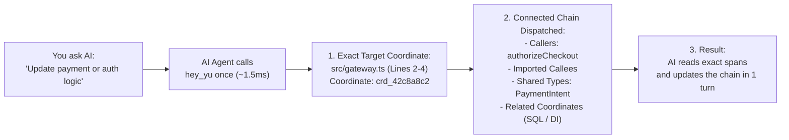
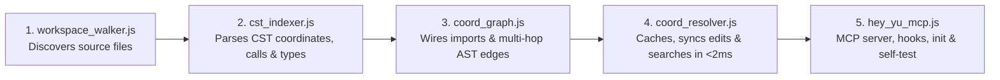

# Coordinate of Code (`hey-yu`) — v0.1.0-alpha

**Turn Your Codebase into a Chessboard for AI Coding Agents. Exact AST Coordinates & Connected Dependency Chains in 1 Step (`~1.5ms`).**

`Coordinate of Code (hey-yu)` is a lightweight **Coordinate Dispatcher** that assigns every function, class, method, data type, interface, and schema in your project an exact spatial coordinate (like squares on a chessboard: `e4`, `Nf3`, `d8`) and maps the real AST connections between them. Instead of your AI coding agent wandering blindly through dozens of files — or editing one file while forgetting a connected caller, validator, or shared contract — `hey-yu` hands the AI the exact file, the exact line numbers, and the connected dependency chain across your project in **one single step (`~1.5ms`)**.

> [!IMPORTANT]
> **What `hey-yu` Is (and What It Is Never):**
> `hey-yu` is a **100% local, open-source (MIT) AST Coordinate Dispatcher and Model Context Protocol (MCP) server** that plugs directly into your code editor and AI agent (**Cursor**, **Claude Code**, **Google Antigravity**, **Windsurf**, **Gemini CLI**).
> It is **NEVER** a GitHub App, PR bot, or Git diff checker, and it **never** uploads your source code to any cloud server.

---

## Table of Contents
1. [The Problem: Why AI Coding Agents Struggle as Your Project Grows](#1-the-problem-why-ai-coding-agents-struggle-as-your-project-grows)
2. [The Solution: How `hey-yu` Works (The Chessboard & Dispatcher Principle)](#2-the-solution-how-hey-yu-works-the-chessboard--dispatcher-principle)
3. [Quick Start: Install, Test & Uninstall in 60 Seconds](#3-quick-start-install-test--uninstall-in-60-seconds)
4. [What You See Live in Chat: Human-Readable Coordinate Logs](#4-what-you-see-live-in-chat-human-readable-coordinate-logs)
5. [Partner Libraries & Why Each One Matters (Zero-Crutch Architecture)](#5-partner-libraries--why-each-one-matters-zero-crutch-architecture)
6. [Inside the 5-File Engine (`engine/`) — Plain English + Technical Guide](#6-inside-the-5-file-engine-engine--plain-english--technical-guide)
7. [The 5 Reliability Guarantees (Live Sync, Memory Safety, Polyglot Scale)](#7-the-5-reliability-guarantees-live-sync-memory-safety-polyglot-scale)
8. [Core Hypothesis, Scope & Known Limitations (Honest Engineering Notes)](#8-core-hypothesis-scope--known-limitations-honest-engineering-notes)
9. [Frequently Asked Questions (FAQ)](#9-frequently-asked-questions-faq)
10. [License](#10-license)

---

## 1. The Problem: Why AI Coding Agents Struggle as Your Project Grows

### In Plain English (For Everyone)

Modern AI models (Claude, Gemini, GPT) are brilliant at reasoning and writing code **once they are looking at the right lines**. So why do developers still spend hours fighting broken builds and repeating prompts when using AI agents on real projects?

Because as soon as your project has more than a few files, your AI agent hits **three walls**:

1. **Wall #1: Playing Chess Blindfolded (Wandering Through Files)**
   When you ask an AI agent to *"update how JWT token revocation works"*, the AI does not know where that code lives. Without coordinates, it has to guess keywords, run 5 to 10 text searches (`grep` / `find`), and read entire 500-line files from top to bottom just to orient itself.
2. **Wall #2: The Domino Effect of Forgotten Dependencies (Fixing 1 File, Breaking 3 Others)**
   In a real project, no piece of code stands alone — everything is connected:
   - A **controller or filter** calls a **validator or service** ->
   - The **service** depends on a **shared data contract / struct / interface** ->
   - And companion **SQL schemas, migrations, or implementations** share the same domain identifiers or error literals.
   When you ask your AI to add a new required field or change a signature, the AI often edits the first file it finds and forgets the caller in another folder or the shared type in `auth/`.
3. **Wall #3: The "Same Name, Wrong File" Trap (`validate`, `save`, `execute`)**
   Almost every project has 15 different functions named `validate()`, `save()`, or `process()` in different folders. Ordinary text search dumps all 15 matches onto the AI at once.

---

### Technical Deep Dive (For Engineers & Architects)

Standard agent harnesses rely on unstructured lexical search (`ripgrep` / `grep`) and file-globbing (`find`):
- **Lack of AST Declaration Boundaries:** `grep` returns isolated matching lines (`line 84`) without knowing that the enclosing function, method, or struct spans `lines 72–118`. The agent is forced to issue multiple speculative `read_file` calls.
- **Zero Lexical or Module-Graph Scoping:** Text search treats every occurrence of an identifier equally. It cannot distinguish between a `validate()` function that is actually imported by the target module (via `tsconfig.json` path aliases, Go package imports, Rust `use crate::...`, Java/C# package imports, or Python relative imports) and 20 unrelated homonyms across the repository.
- **Unidirectional Context Blindness:** Even when an agent finds the target function, a local file read only shows outbound calls inside that file; it does not reveal **inbound callers** (`who calls this function across the repo?`), **transitive 2nd/3rd-hop contracts**, or **related coordinates** across companion files.

---

## 2. The Solution: How `hey-yu` Works (The Chessboard & Dispatcher Principle)

### In Plain English (For Everyone)

Think about how two chess grandmasters talk about a game. They never say: *"Look around the middle of the board for a tall piece near some pawns."*
They say: **`Queen to d8` (`Qd8`)**.
Why? Because on a chessboard:
1. Every square has an **exact coordinate** (`a1` through `h8`).
2. Once you look at square `d8`, you immediately see **every line of sight** — which pieces defend `d8`, and which pieces `d8` attacks across the board.

**`hey-yu (Coordinate of Code)` acts purely as a high-speed Coordinate Dispatcher for your AI agent:**



Here is how `hey-yu` helps your AI agent:

1. **Exact Target Coordinate + Superficial Dependency Chain (`EXISTING_FOUND`):**
   Before the AI starts guessing files, it asks `hey-yu` once. In **~1.5 milliseconds**, `hey-yu` returns:
   - **The Exact Target Square:** The exact file path and exact start-to-end lines of the function, method, or type (`src/gateway.ts:2-4`).
   - **Connected Pieces (`impact_graph` + `required_file_spans`):** Every caller that invokes this symbol (`incoming_callers`), every imported helper it calls (`imported_callees`), and every shared data type/interface (`shared_types`).
   - **Related Coordinates (`related_coordinates`):** Up to 4 additional high-relevance coordinates in other files (such as DI interface implementations, `.proto` contracts, or `.sql` migrations sharing the same identifiers or literals).
2. **When `hey-yu` Is Not Needed (`Honest Silent Pass`):**
   If you ask your AI to run a `git` command, edit a README, tweak a Dockerfile, or search for something that does not exist yet, `hey-yu` never guesses and never gets in the way. It immediately returns `pass: true` in `<1ms` and lets the AI work normally with zero noise.

| Everyday Task | Without `hey-yu` (Blind Search) | With `hey-yu` (Coordinate Dispatcher) |
| :--- | :--- | :--- |
| **Finding where a symbol or error string lives** | 5–10 `grep` / `find` calls + reading whole files | **1 call (`~1.5ms`)** -> exact file & exact `start-end` lines |
| **Updating a signature or shared contract** | Edits 1 file, forgets caller or shared type -> build breaks | Dispatches the **connected callers, callees, shared types & related coordinates** in 1 step |
| **Searching a common name like `validate()`** | Floods AI memory with unrelated `validate` functions | Follows **real imports & package boundaries** -> zero false homonym edges |

### Silent Observer & Partner-Library AST Auto-Dispatcher Flow (Tree View)

`hey-yu` **never hijacks your initial prompt** and never guesses intent with brittle regexes. Instead, the AI agent's own LLM intelligence processes your prompt first, and `hey-yu` silently observes subsequent tool steps through its partner libraries:

```text
[1] USER SENDS PROMPT
 │   ├─ "What is the chat ID?" / "Hello" / "Explain this architecture"
 │   └─ "Fix calculateTaxCents in the billing module"
 ▼
[2] AI AGENT PROCESSES PROMPT FREELY (Zero Step-1 Interception by hey-yu)
 │   │
 │   ├──► Branch A: Agent answers directly (no code search needed)
 │   │     └──► Instant reply to user (hey-yu did 0 work, 0 interference)
 │   │
 │   └──► Branch B: Agent decides to invoke a tool (`hey_yu`, `grep_search`, `find_by_name`, `read_file`, `run_command`)
 │         ▼
[3] HEY-YU SILENT AST OBSERVER (`PreToolUse` Partner-Library Gates, ~1.5ms)
           │
           ├─► Gate 1: Workspace Boundary (`pathe` + `ignore`)
           │    └─ Target outside projectRoot or in `.git` / `node_modules` / `.agents`?
           │       └──► 100% SILENT PASS (`{"decision": "allow"}`)
           │
           ├─► Gate 2: Tree-sitter AST Competence (`@lumis-sh/lumis` + `@lumis-sh/wasm-bundle-full`)
           │    └─ Non-AST file (`.md`, `.json`, `.jsonl`, `.txt`, `.env`) or non-search command (`git`, `npm`, `docker`)?
           │       └──► 100% SILENT PASS (`{"decision": "allow"}`)
           │
           └─► Gate 3: AST Coordinate & Dependency Resolution (`web-tree-sitter` + `@orama/orama` + `oxc-resolver` + `graphology`)
                ├─► Symbol not in AST index (`pass: true`)
                │    └──► 100% SILENT PASS (`{"decision": "allow"}`)
                │
                └─► Symbol resolved (`EXISTING_FOUND`, `pass: false` in ~1.5ms)
                     └──► AUTO-DISPATCHES EXACT COORDINATES TO AGENT:
                          ├─ Cadastral ID (`crd_...`), exact file & `line_span` (`start-end`) + `code_preview`
                          ├─ Connected Dependency Chain (`incoming_callers`, `imported_callees`, `shared_types`)
                          ├─ Companion `related_coordinates` (e.g., SQL schemas / DI contracts)
                          └─ 1-line human-readable status report in chat: `[hey-yu] Resolved ...`
```

---

### Technical Deep Dive (For Engineers & Architects)

Under the hood, `hey-yu` achieves 1-step spatial and dependency resolution through **three universal AST & graph mechanisms** implemented in [`engine/coord_graph.js`](./engine/coord_graph.js) and [`engine/coord_resolver.js`](./engine/coord_resolver.js):

1. **Deterministic Cadastral Coordinates (`crd_<xxh64>`) & Structural Merkle Hashes (`mrk_<xxh64>`):**
   Every file and CST declaration node (`function`, `method`, `type`) is hashed with `xxhash-wasm` (`h64ToString`) over its normalized path, kind, and symbol identity, plus a structural Merkle hash over its AST children so structural edits are detected instantaneously.
2. **`Import-Scoped Edge Filter` (Eliminating Homonym Collisions):**
   When constructing `CALLS_COORD` and `USES_TYPE` edges in `graphology`, a call site or type reference in File $A$ is linked to a symbol declaration in File $B$ **if and only if**:
   - File $A$ explicitly imports File $B$ (`IMPORTS_FILE` resolved via `oxc-resolver` for JS/TS/tsconfig aliases or polyglot module/package resolution for Go, Rust, Python, Java, C#, C++, PHP);
   - Or the target symbol is declared inside File $A$ itself (`localSymbols`);
   - Or File $B$ resides in the same package directory (`sameDirFiles`, honoring Go/Java/C#/C++ package visibility);
   - Or the symbol name is globally unique across the entire workspace (`globalMatches.length === 1`).
3. **`Multi-Hop Dependency Walk` (`bfsFromNode`) + `Related Coordinates`:**
   Starting from the resolved target coordinate, `extractCoordDependencies()` runs breadth-first traversal (`bfsFromNode` from `graphology-traversal`) **up to 2 hops inbound** (`incoming_callers`) and **up to 3 hops outbound** (`imported_callees` and `shared_types`), assembling `coordinate_dispatcher.required_file_spans` — a deduplicated list of exact `[startLine, endLine]` ranges — plus top cross-file BM25 hits (`related_coordinates`) for non-imported companion files (such as SQL schemas or DI implementations).

---

## 3. Quick Start: Install, Test & Uninstall in 60 Seconds

### Prerequisites & Supported Environments
- **Node.js:** `>= 18.18.0` (Node 20+ recommended) and `npm >= 9`
- **Operating Systems:** macOS, Linux, Windows (POSIX-normalized via `pathe`)
- **Supported AI Editors & Harnesses:** Cursor, Claude Code, Google Antigravity, Windsurf, Gemini CLI (or any MCP-compatible client over `stdio`)

### Option A: Copy-Paste Prompt for Your AI Agent (Per-Project Local Install)
Open your AI coding agent **directly inside your project directory** (we recommend installing `hey-yu` into each individual project directory rather than at the root of a multi-project monorepo) and paste:

```text
Install hey-yu (Coordinate of Code) locally into this project workspace by running:
1. If ./.hey-yu does not exist, run: git clone https://github.com/yuyurooms/hey-yu.git ./.hey-yu && npm --prefix ./.hey-yu install
2. Run: node ./.hey-yu/engine/hey_yu_mcp.js init .
3. Run: node ./.hey-yu/engine/hey_yu_mcp.js self-test and confirm that all checks pass.
```

### Option B: Run in Terminal + 2-Second Self-Test Fixture
```bash
# 1. Install dependencies & run the built-in self-test fixture (TypeScript + SQL + Lifecycle Hooks)
npm install
npm test

# 2. Provision hey-yu into any target project directory
node ./engine/hey_yu_mcp.js init --project /path/to/your-project
```

Expected output of `npm test`:
```text
[hey-yu] Resolved function "calculateTaxCents" (crd_...) -> src/tax.ts:2-4 in 1.5ms | Dependencies: 1 Callers [settleInvoice (src/billing.ts:3-7)], 1 Shared Types [InvoiceRequest (src/types.ts:1-5)] | Reading Plan: 4 exact spans across 3 files | Related Coordinates: [tenant_invoices (db/schema.sql:1-4)]
[hey-yu] Resolved type "InvoiceRequest" (crd_...) -> src/types.ts:1-5 in 0.2ms | Dependencies: 2 Callers [settleInvoice (src/billing.ts:3-7), calculateTaxCents (src/tax.ts:2-4)] | Reading Plan: 3 exact spans across 3 files | Related Coordinates: [tenant_invoices (db/schema.sql:1-4)]
{
  "self_test": "PASSED",
  "checks": {
    "symbol_resolved": true,
    "has_caller": true,
    "has_shared_type": true,
    "cross_file_sql_related": true,
    "silent_pass_works": true,
    "hooks_intercept_and_log": true
  }
}
```

### Clean Uninstall (Removing `hey-yu` from a Project)
To cleanly remove `hey-yu` MCP entries, rules, hooks, and `.coordinate/` cache from a workspace without touching any other settings:
```bash
node ./engine/hey_yu_mcp.js uninstall --project /path/to/your-project
```

---

### Technical Deep Dive: What `hey-yu init` Provisions in Your Workspace

Running `node engine/hey_yu_mcp.js init --project <dir>` is **100% non-destructive** (it merges JSON keys and upserts HTML-comment-delimited Markdown blocks without overwriting your existing MCP servers, hooks, or team instructions):

1. **4 MCP Server Configurations (Direct `stdio` Node execution):**
   - `.mcp.json`, `.cursor/mcp.json`, `.claude/config.json`, `.windsurf/mcp_config.json`
2. **4 Root Agent Instruction Files (Upserted between `<!-- hey-yu-COORDINATE-OF-CODE:START -->` and `END`):**
   - `AGENTS.md`, `CLAUDE.md`, `GEMINI.md`, `.cursorrules`
3. **3 Editor Rules & Agent Skill Definitions:**
   - `.agents/rules/hey-yu-rule.md`, `.cursor/rules/hey-yu.mdc`, `.agents/skills/hey-yu/SKILL.md`
4. **2 Runtime Lifecycle Hook Interceptors (`~1.2ms` execution):**
   - `.agents/hooks.json` (`SessionStart`, `PreInvocation`, `PreToolUse`)
   - `.claude/settings.json` (`UserPromptSubmit`, `PreToolUse`)

---

## 4. What You See Live in Chat: Human-Readable Coordinate Logs

Whenever `hey-yu` resolves a coordinate (`EXISTING_FOUND`), your AI agent outputs a **single, clean, human-readable status line** (and logs it to `.coordinate/live_audit.log`):

```text
[hey-yu] Resolved function "sendToGateway" (crd_42c8a8c2) -> src/gateway.ts:2-4 in 1.8ms | Dependencies: 1 Callers [authorizeCheckout (src/checkout.ts:3-5)], 1 Shared Types [PaymentIntent (src/types.ts:1-4)] | Reading Plan: 4 exact spans across 3 files
```

How to read this line in 2 seconds:
- **`Resolved function "sendToGateway" (crd_42c8a8c2) -> src/gateway.ts:2-4 in 1.8ms`**:
  `hey-yu` located `sendToGateway` in `src/gateway.ts` on lines `2–4` in `1.8ms`.
- **`Dependencies: 1 Callers [authorizeCheckout (src/checkout.ts:3-5)], 1 Shared Types [PaymentIntent (src/types.ts:1-4)]`**:
  `hey-yu` traced the project's import graph and found who calls `sendToGateway` and which shared contract they exchange.
- **`Reading Plan: 4 exact spans across 3 files`**:
  Instead of searching blindly, the AI received the exact line ranges across all 3 connected files.

*(When `hey-yu` returns `pass: true` on non-code tasks like `git status`, it stays 100% silent — zero chat noise.)*

---

## 5. Partner Libraries & Why Each One Matters (Zero-Crutch Architecture)

`hey-yu` contains zero homemade regex parsers and zero single-framework keyword lists. Every layer delegates to battle-tested open-source partner libraries:

| Partner Library | Specific Features & APIs Used | What It Does Inside `hey-yu` | Concrete Value for the User |
| :--- | :--- | :--- | :--- |
| **`web-tree-sitter`** | `Parser`, `Language.load`, `Query`, `captures()`, `includedRanges`, `childForFieldName()`, `tree.delete()` | Parses source files into official Concrete Syntax Trees (CST) in WebAssembly, extracts exact `[startLine, endLine]` declaration boundaries, walks AST fields (`name`, `function`, `type`, `body`), and parses multi-language injections. | **100% exact line boundaries** (`line_span`) with deterministic WASM memory cleanup (`tree.delete()`). |
| **`@lumis-sh/wasm-bundle-full`** & **`@lumis-sh/lumis`** | `getLanguage()`, precompiled `.wasm` grammars, official `highlights.scm` & `injections.scm` S-expression queries | Identifies the language of any file path or extension and supplies official Tree-sitter `.wasm` parsers and `.scm` query files for **110+ languages** (TS/JS, Python, Go, Rust, Java, C/C++, C#, PHP, Ruby, Swift, Kotlin, SQL, Protobuf, Vue, Svelte, etc.). | **Universal polyglot support** across Backend, CLI, Systems, Mobile, SQL, and Web repositories. |
| **`oxc-resolver`** | `ResolverFactory`, `resolveFileSync()`, `tsconfig.json` (`paths`, `extends`), `package.json` (`exports`, `imports`), `extensionAlias` | Resolves cross-file module imports (`import { x } from "@/services/billing"`, barrel `index.ts` re-exports, ESM `.js` -> `.ts` aliases) at native Rust/N-API speed. | Ensures the dependency graph follows **real compiler-accurate imports** even in monorepos with path aliases. |
| **`graphology`** & **`graphology-traversal`** | `DirectedGraph`, `bfsFromNode()`, `inNeighbors()`, `outNeighbors()` | Stores file and symbol coordinate nodes and directed edges (`CONTAINS`, `IMPORTS_FILE`, `CALLS_COORD`, `USES_TYPE`), running multi-hop breadth-first traversal. | Powers the **Coordinate Dispatcher Dependency Walk** (`incoming_callers`, `imported_callees`, `shared_types`). |
| **`@orama/orama`** | `create()`, `insertMultiple()`, `search()` with per-field BM25 `boost` weights | Indexes every coordinate's `name`, `name_words` (camelCase/snake_case split), `literals`, `origin_file`, `file_words`, `referenced_types`, and `calls` in memory. | Delivers **`<2ms` instant search** whether the AI searches by symbol name, error code, UI text, or SQL identifier. |
| **`xxhash-wasm`** | `xxhash()`, `h64ToString()` | Computes 64-bit non-cryptographic hashes in WebAssembly for coordinate IDs (`crd_<xxh64>`) and structural AST Merkle hashes (`mrk_<xxh64>`). | **Deterministic coordinate IDs** and instant detection of structural code changes. |
| **`ignore`** | `ignore().add()`, `.ignores()` | Parses root `.gitignore` and nested package `.gitignore` files according to the official Git specification. | Automatically skips `node_modules`, build folders, and ignored artifacts across nested monorepos. |
| **`pathe`** | `resolve()`, `relative()`, `join()`, `dirname()`, `extname()`, `normalize()` | Normalizes all file and module paths to clean POSIX forward-slash format (`a/b/c.ts`) across macOS, Linux, and Windows. | Guarantees **cross-platform consistency** across operating systems. |
| **`zod`** | `z.object()`, `.safeParse()`, `z.toJSONSchema()` | Validates incoming MCP tool arguments (`hey_yu`, `yu_get_project_map`) and generates JSON Schema definitions for MCP `tools/list`. | **Strict protocol safety** across MCP clients. |

---

## 6. Inside the 5-File Engine (`engine/`) — Plain English + Technical Guide

The entire `hey-yu` engine consists of **5 single-responsibility files** inside [`engine/`](./engine/):



1. **[`engine/workspace_walker.js`](./engine/workspace_walker.js) — The Project Scout:**
   Walks the repository honoring cascading `.gitignore` rules (`ignore`), skips binary/minified/generated files (`>1MB`), and maps each source file to its Tree-sitter grammar via `@lumis-sh/lumis` and `@lumis-sh/wasm-bundle-full`.
2. **[`engine/cst_indexer.js`](./engine/cst_indexer.js) — The Polyglot CST Scanner:**
   Parses each source file in WebAssembly (`web-tree-sitter`), executes official `highlights.scm` and `injections.scm` queries, extracts exact declaration `line_span` boundaries (`function`, `method`, `type`), collects outbound `calls`, `referenced_types`, `literals`, and `imports`, mints `crd_<xxh64>` / `mrk_<xxh64>`, and deterministically frees WASM heap objects (`tree.delete()`).
3. **[`engine/coord_graph.js`](./engine/coord_graph.js) — The Dependency Graph Builder:**
   Resolves cross-file imports via `oxc-resolver` and polyglot module/package suffix matching, wires `IMPORTS_FILE`, `CALLS_COORD`, and `USES_TYPE` edges in `graphology`, and runs `bfsFromNode` to extract `incoming_callers`, `imported_callees`, `shared_types`, and `required_file_spans`.
4. **[`engine/coord_resolver.js`](./engine/coord_resolver.js) — The Instant Memory & Search Engine:**
   Persists `.coordinate/ast_cache.json`, incrementally re-parses only files whose `mtimeMs:size` changed, indexes coordinates in `@orama/orama`, resolves queries in `<2ms` hot, attaches cross-file `related_coordinates`, and formats `user_status_line`.
5. **[`engine/hey_yu_mcp.js`](./engine/hey_yu_mcp.js) — The MCP Server, Lifecycle Hooks & Installer:**
   Exposes `hey_yu` and `yu_get_project_map` over JSON-RPC 2.0 `stdio`, runs `init`, `uninstall`, `self-test`, and lifecycle hooks (`evaluateLifecycleHook`).

---

## 7. The 5 Reliability Guarantees (Live Sync, Memory Safety, Polyglot Scale)

1. **Incremental `mtimeMs:size` Sync (`<1ms` check):** `CoordinateResolver.sync()` runs before every query, re-indexing only modified files so line numbers are never stale after edits.
2. **Deterministic WASM Heap Disposal:** Every `web-tree-sitter` `Tree`, injected `subTree`, and `Parser` is freed via `.delete()` inside `try ... finally` blocks.
3. **Persistent Disk Cache:** `.coordinate/ast_cache.json` persists parsed CST metadata across sessions for fast cold starts.
4. **Multi-Language Injection Support:** Embedded languages (such as `<script>` inside Vue/Svelte or SQL inside host files) are parsed via `injections.scm` + `includedRanges`.
5. **100% Local & Private:** Zero network calls, zero telemetry uploads, zero cloud dependencies.

---

## 8. Core Hypothesis, Scope & Known Limitations (Honest Engineering Notes)

We believe engineering tools should state clearly what is deterministically guaranteed today, what is an empirical hypothesis under continuous testing, and where the intentional boundaries of the tool lie:

1. **Core Testable Hypothesis:**
   Giving an AI coding agent 1-step access (`~1.5ms`) to exact AST declaration coordinates (`file:start-end`), superficial cross-file AST dependencies (`incoming_callers`, `imported_callees`, `shared_types`), and lexical `related_coordinates` reduces blind `grep`/`read_file` loops and lowers the rate of forgotten companion contracts on multi-file tasks.
2. **What Is Deterministically Proven vs. What Depends on the Model & Task:**
   - **Deterministically Proven:** Sub-15ms hot in-memory resolution (`0.2ms–2.6ms` across polyglot benchmarks in TypeScript, Java Spring Boot/Security, Rust, Protobuf, and SQL), exact Tree-sitter CST start/end line spans, and import-scoped edge filtering.
   - **Task- & Model-Dependent (Under Continuous Evaluation):** Total token savings, wall-clock task completion speedup, and first-try pass rates vary depending on task complexity (1-file edits see minimal difference vs. 5-file architectural chains) and how strictly a given LLM follows MCP tool hints.
3. **Intentional Design Boundaries & Known Limitations (What `hey-yu` Does Not Do):**
   - **Dispatcher, Not a Compiler or Full LSP:** `hey-yu` intentionally provides a fast, superficial AST dependency chain (`IMPORTS_FILE`, `CALLS_COORD`, `USES_TYPE`) + `related_coordinates` and leaves deep semantic reasoning to the AI agent.
   - **Dynamic Reflection, Macros & Runtime DI:** When classes are wired purely via runtime reflection, dependency injection interfaces, or external SQL/config files without direct AST calls, `hey-yu` does not guess fake call edges — instead, it surfaces the interface coordinate and ranks matching implementations/migrations in `related_coordinates` via BM25 token/literal matching.
   - **Per-Project Installation Scope (Avoid Multi-Project Monorepo Roots):** Install `.hey-yu` and open your AI editor directly inside each individual project directory (`project_a/`, `project_b/`) rather than at the top-level root of a giant multi-project monorepo, so each project maintains its own isolated `.coordinate/` graph and editor rules.
   - **Brand-New / Non-Existent Code:** When searching for symbols that do not yet exist in the codebase, `hey-yu` returns `pass: true` so the agent can proceed with standard tools.
4. **Controlled Single-Pilot A/B Experiment Summary (Login Email Validation & Propagation across 16-file TypeScript/SQL Fixture):**
   - **Task:** Fix empty/whitespace-only `email` validation (`EMPTY_EMAIL`), normalize `email` (`trim().toLowerCase()`), and propagate `errorCode` + `normalizedEmail` to `AuthController.handleLogin` and `recordLoginAttempt` without touching 11 distractor files or altering public contracts.
   - **Results (`n = 1` paired pilot, identical model & test suite):**
     - **Automated Test Suite:** `6/6 PASSED` (Baseline) vs. `6/6 PASSED` (With `hey-yu`), `0` regressions or out-of-scope file edits in either run.
     - **Discovery & Scanning:** Baseline required a filesystem scan (`find . -type f`) and full-file reads (`85` lines); Treatment (`hey-yu`) resolved target, callers (`AuthController.handleLogin`), shared types (`LoginCredentials`, `LoginValidationResult`), and related SQL (`auth_login_attempts`) in **`1.9ms`** (`0` `find`/`grep` scans) and read **`68` lines** across exact AST spans (**`-20.0%` fewer lines read**).
     - **Honest Takeaway on Small vs. Large Files:** On small repositories (`<20` files) with short files (`20–40` lines) and obvious filenames, total LLM turns (`4` vs `4`) were identical and total input tokens were slightly higher (`+6.1%`) due to the JSON graph payload. `hey-yu`'s primary advantage emerges on larger multi-module files (`300–2,000+` lines) and non-obvious cross-file call chains where reading exact `[startLine, endLine]` spans avoids loading entire files or missing callers.

---

## 9. Frequently Asked Questions (FAQ)

### Q1: Why can't my AI agent just use `ripgrep` (`grep`) and `find`?
`grep` matches raw text lines without knowing AST declaration boundaries (`startLine..endLine`), inbound callers, or import scoping. On multi-file changes, `hey-yu` gives the agent the target span plus the connected callers, callees, shared types, and related coordinates in a single `<2ms` call.

### Q2: Can I use `hey-yu` directly from a Node.js script?
Yes! Import `CoordinateResolver` directly in any Node.js (`>=18.18`) script:
```javascript
import { CoordinateResolver } from './engine/coord_resolver.js';

const resolver = new CoordinateResolver('/absolute/path/to/your-project');
await resolver.init();

const hit = await resolver.resolve({
  query: 'calculateTaxCents',
  semantic_tokens: ['tax', 'invoice'],
  expected_kind: 'function'
});
console.log(hit.user_status_line);
```

### Q3: Where can I report bugs, edge cases, or benchmark results?
Please open an issue in [GitHub Issues](https://github.com/yuyurooms/hey-yu/issues) with the language/stack, query, and output of `.coordinate/live_audit.log`.

---

## 10. License

Distributed under the **MIT License**. See [LICENSE](./LICENSE) and [THIRD_PARTY_NOTICES.md](./THIRD_PARTY_NOTICES.md) for full details.
