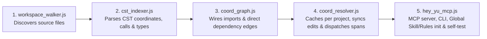

# hey-yu (Coordinate of Code)

### The Navigation & Dependency Layer for AI Coding Agents.

> **No matter which AI model you use, do you want your coding agent to find the right place to change — understand what depends on it — and get closer to the result you intended?**

**The problem isn't how fast AI writes code — it's how accurately your agent understands *where* to make a change (Precision) and *what else that change affects* (Dependency Awareness).**

`Open-Source (MIT License)` · `100% Local-First` · `110+ Tree-sitter Language Grammars` · `Works with Claude Code, Cursor, Antigravity, Windsurf, Codex & Gemini CLI`

> **Alpha Release (`v0.1.0-alpha`):** `hey-yu` is an early-stage open-source project from **yuyurooms AI Lab**. We are looking for developers working with AI coding agents to test real-world repositories, report edge cases in [GitHub Issues](https://github.com/yuyurooms/hey-yu/issues), and help shape structural code navigation.

---

## The Real Problem: Why Great Models Fail on Real Codebases

AI coding agents are getting remarkably good at writing code. Yet getting the exact result you intended on a real multi-folder project is still frustratingly difficult.

You've probably experienced this: **You spend hours working with a powerful AI coding agent on what seems like a straightforward task. It reads files, makes changes, fixes errors — but somehow, the result is still not what you intended:**
- **Hour 1 — Blind Search & Partial Hits:** The agent runs `grep` and `find`, reads 10–15 files across your repo, and modifies the target code — but because file imports only point one way (what a file *imports*, not what *depends on it* from other directories), it misses an upstream caller, a shared type consumer, or a database trigger.
- **Hour 2 — Patching Symptoms:** A connected route or build check breaks. You paste the error into chat; the agent patches the symptom while breaking another contract elsewhere.
- **Hour 3 — Context Drift & Rework:** As the agent reads unrelated files, chases follow-up errors, and revisits earlier edits, it gradually drifts away from the actual structure of your codebase and starts overwriting working code.

**The bottleneck isn't the model's IQ — it's that without structural navigation, your agent is playing Battleship blindfolded across your repository.**

---

## Precision + Dependency Awareness: Why Coordinates & Connections Belong Together

Why is the project called **Coordinate of Code (`hey-yu`)**? Because changing real software requires solving two different spatial problems before the agent edits anything:

> **A coordinate tells the agent where to work. Dependencies help it understand the potential impact of that work.**

```text
01. PRECISION — WHERE (Battleship)            02. DEPENDENCY AWARENESS — WHAT'S CONNECTED (Chess)
──────────────────────────────────            ───────────────────────────────────────────────────
In Battleship, firing blindly across the      In Chess, knowing a piece is on e4 is not enough —
board hits one cell of a multi-cell ship      you also need to see what it protects, what attacks
while missing the rest of the hull.           it, and how a move changes the position.
In code, hey-yu gives the exact coordinate    In code, a function or type is connected to callers,
(file, declaration, and lines [start..end])   consumers, imported functions, shared types, and
so the agent stops wandering across files.    related structures across your repository.
```

### What Your Agent Actually Receives: Exact Coordinates & Dependency Context

Instead of dumping raw file text or leaving the agent to guess via `grep`, `hey-yu` acts as a fast coordinate dispatcher (`Resolved in 1.9ms` on cached lookup) and returns the target coordinate together with its direct dependency links:

```text
Database (crd_2583049d) — Resolved in 1.9ms (cached lookup)
  ├── Target Coordinate (Precision — WHERE)
  │   └── type Database -> lib/database.types.ts:12-252
  │
  ├── Incoming References & Consumers (Dependency Awareness — WHAT'S CONNECTED)
  │   ├── createAdminClient    (lib/supabase/admin.ts:6-17)
  │   ├── createClient         (lib/supabase/client.ts:4-9)
  │   ├── createClient         (lib/supabase/server.ts:5-28)
  │   ├── DashboardShellProps  (components/layout/DashboardShell.tsx:9-12)
  │   └── SidebarProps         (components/layout/Sidebar.tsx:20-24)
  │
  └── Dispatcher Reading Plan (coordinate_dispatcher.required_file_spans)
      └── 6 exact [startLine..endLine] spans across 6 files
```

| Capability inside `hey-yu` | What your AI agent gets | Why it matters in daily coding |
| :--- | :--- | :--- |
| **Syntax-Tree Coordinates (`crd_...`)** | **Precision — Exact Target Spans** | Every function, method, class, type, and SQL table gets a deterministic coordinate (`crd_...`) with exact `[startLine, endLine]` boundaries and `coordinate_dispatcher.required_file_spans`. |
| **Import-Aware Dependency Graph** | **Dependency Awareness — Direct Impact Context** | Dispatches direct `incoming_callers` (callers and type consumers), `imported_callees`, `shared_types`, and `related_coordinates` so the agent sees the connected blast radius before editing. |
| **Import-Scoped Symbol Disambiguation** | **Avoids Homonym Mix-Ups** | If your repo has multiple functions named `validate()` or `createClient()`, `hey-yu` traces module imports (`oxc-resolver` for TS/JS + polyglot path resolution) to connect the right declaration. |
| **Honest Silent Pass (`pass: true`)** | **Zero Noise on Unrelated Tasks** | When you chat normally, edit `.md` / `.json` files, run `git status`, or create a brand-new symbol that does not exist yet, `hey-yu` returns `pass: true` and stays out of the way. |

### `hey-yu` in One Word: A Dispatcher (And Why That Matters)

`hey-yu` is a **pure coordinate dispatcher** — not an agent, not a RAG code dump, and not a static linter.
- **Why a dispatcher?** When a tool tries to do deep multi-hop analysis or stuff raw source code into MCP responses, it slows down and floods the model's context window with noise.
- **How a dispatcher works:** Like air traffic control, `hey-yu` does one job in milliseconds — it hands your agent the exact target coordinates (`file:startLine-endLine`) and its direct 1-hop connections (`incoming_callers`, `imported_callees`, `shared_types`), then steps out of the way so your agent and LLM can read only those lines and write the code.

### Where `hey-yu` Fits in Your Stack

`hey-yu` does not replace your editor, your LLM model, your compiler/LSP, or your test suite — it plugs into your coding agent locally via MCP and CLI:

| Layer | Role in your workflow |
| :--- | :--- |
| **Cursor / Windsurf / Google Antigravity** | Your AI code editor |
| **Claude Code / Codex / Gemini CLI** | Your autonomous AI coding agent |
| **`hey-yu` (Coordinate of Code)** | **The local navigation & dependency dispatcher** that gives your agent exact syntax-tree coordinates and connected dependencies before it reads or edits code |

---

## Quick Setup (Install Once Globally — Designed for Multi-Project Workflows)

**Requirements:** [Node.js](https://nodejs.org/) `>= 18.18.0` (Node 20+ recommended), `npm >= 9`, and [Git](https://git-scm.com/). Runs locally on **macOS**, **Linux**, and **Windows** using the **Global Skill + Rules + MCP + CLI fallback** architecture (zero editor hooks, zero files created inside your target repositories).

### Option A: Run from your terminal (Recommended, once per machine)

```bash
# 1. Clone hey-yu and run the built-in self-test (11 automated checks)
git clone https://github.com/yuyurooms/hey-yu.git ~/hey-yu
cd ~/hey-yu
npm install
npm test

# 2. Register hey-yu globally (zero files created inside your project folders)
node ./engine/hey_yu_mcp.js init
```

### Option B: Or ask your AI coding agent to install it

```text
Install hey-yu (Coordinate of Code) globally by running:
1. git clone https://github.com/yuyurooms/hey-yu.git ~/hey-yu && npm --prefix ~/hey-yu install
2. node ~/hey-yu/engine/hey_yu_mcp.js init
3. node ~/hey-yu/engine/hey_yu_mcp.js self-test
```

### Centralized Multi-Project Isolation (Zero Repo Pollution)
- **Your project directories stay untouched:** By default, `init` registers the global MCP server and global `SKILL.md` / rules once. It creates **zero** `.coordinate/`, `.agents/`, `.cursor/`, `.claude/`, or `.mcp.json` files inside your application repositories (pass `--local` only if you explicitly want per-repo config files committed to a shared repo).
- **Why `hey-yu` needs the exact target project directory (`project_root`):**
  - If your editor is opened directly inside a single project, your agent automatically passes that folder as `project_root`.
  - If you work inside a **parent umbrella folder or monorepo containing multiple subprojects** (for example, `mvp/mvp_20_ab1/app123` or `packages/web`), point your prompt to the target project folder (or let the agent resolve the subfolder path first) so `hey-yu` receives **that specific project's directory** as `project_root` rather than the umbrella parent directory. This guarantees:
    1. **Fast per-project indexing & lookup:** `hey-yu` scans and caches only the files of the target application instead of indexing unrelated sibling projects at once.
    2. **Isolated per-project dependency graphs:** Each project's cache (`ast_cache.json`) and logs (`live_audit.log`, `mcp_telemetry.jsonl`) are isolated inside `~/hey-yu/.coordinate/projects/<project_slug>_<xxh32_of_project_root>/`, so common symbol names (`Database`, `createClient`, `page.tsx`) from other projects never mix into your graph.
    3. **Accurate module alias resolution:** Path aliases (`@/...` in `tsconfig.json`) are resolved relative to that specific project's root directory.
- **Clean uninstall anytime:**
  ```bash
  node ~/hey-yu/engine/hey_yu_mcp.js uninstall
  ```

| AI Agent / Editor | Integration Status | Configured by `init` (Global Default vs. Optional `--local`) | How the Agent Calls `hey-yu` (Dual Channel) |
| :--- | :--- | :--- | :--- |
| **Google Antigravity (CLI & IDE)** | Verified end-to-end | `~/.gemini/*/mcp_config.json`, `~/.gemini/config/skills/hey-yu/SKILL.md`, `~/.gemini/config/rules/hey-yu-rule.md`, `~/.gemini/GEMINI.md` | **Method 1:** MCP (`hey_yu`, `yu_get_project_map` with `project_root`)<br/>**Method 2:** CLI (`node ~/hey-yu/engine/hey_yu_mcp.js resolve "<query>" "<project_root>"`) |
| **Claude Code** | Standard MCP + CLI | Global skill/rules (or `.mcp.json`, `.claude/config.json`, `CLAUDE.md` with `--local`) | **Method 1:** MCP (`hey_yu`, `yu_get_project_map` with `project_root`)<br/>**Method 2:** CLI (`node ~/hey-yu/engine/hey_yu_mcp.js resolve "<query>" "<project_root>"`) |
| **Cursor** | Standard MCP + CLI | Global skill/rules (or `.cursor/mcp.json`, `.cursor/rules/hey-yu.mdc`, `.cursorrules` with `--local`) | **Method 1:** MCP (`hey_yu`, `yu_get_project_map` with `project_root`)<br/>**Method 2:** CLI (`node ~/hey-yu/engine/hey_yu_mcp.js resolve "<query>" "<project_root>"`) |
| **Windsurf** | Standard MCP + CLI | Global skill/rules (or `.windsurf/mcp_config.json`, `AGENTS.md` with `--local`) | **Method 1:** MCP (`hey_yu`, `yu_get_project_map` with `project_root`)<br/>**Method 2:** CLI (`node ~/hey-yu/engine/hey_yu_mcp.js resolve "<query>" "<project_root>"`) |
| **Codex / Gemini CLI / VS Code** | Standard MCP + CLI | Global MCP + Skill (or `.mcp.json`, `AGENTS.md` with `--local`) | Standard JSON-RPC 2.0 MCP over `stdio` + direct Node.js CLI fallback |

---

## Real-World Case Study: Auditing a 63-File App with a Misplaced `app/` Directory

Instead of synthetic toy snippets, here is a controlled side-by-side case study we ran on a 63-file full-stack repository (`mvp/mvp_20_ab1/app123` — Next.js 15 + React 19 + TypeScript + Supabase + 12 SQL migrations + Gemini Embedding 2 / Pinecone).

### Predefined Audit Checklist Planted in `app123`
Before running the test, the repository contained six specific architectural and launch issues across different layers:
1. **Misplaced `app/` Directory Inside `.next/app/`:** The Next.js App Router source tree (`app/layout.tsx`, `app/page.tsx`, `app/actions.ts`, API routes, dashboard, contract generator) was sitting inside **`.next/app/`** — a build-output folder ignored by `.gitignore`. Running `npm run dev` or `npm run build` without moving it back to `./app` first would fail or overwrite the source files.
2. **Hardcoded Keys in `Dockerfile`:** Sensitive environment keys (`SUPABASE_SERVICE_ROLE_KEY`, `GOOGLE_GENERATIVE_AI_API_KEY`, `PINECONE_API_KEY`, `RESEND_API_KEY`) were hardcoded on lines `20–27` of `Dockerfile`.
3. **Suppressed Build Checks:** `next.config.ts` (lines `8–13`) had `typescript: { ignoreBuildErrors: true }` and `eslint: { ignoreDuringBuilds: true }`.
4. **12 SQL Migrations (`0001`–`0009` + miner schema):** Triggers (`0004_triggers.sql`), RLS policies (`0002_rls.sql`), handover acts (`0008_handover_acts.sql`), and storage buckets that must be applied in order.
5. **External Scraper & Ingestion Pipeline:** `scraper/listings_scraper.js` and `seed-properties.mjs` (`generateProperty`).
6. **AI Chat & Document OCR Routes:** `components/AIChatWidget.tsx` and the API routes powering RAG + OCR.

### Test Methodology
We sent the exact same prompt across two independent, clean chat sessions starting from the exact same project state, using the same environment (Google Antigravity) and model configuration (`gemini 3.8 flash medium`, internal Antigravity model tier):
- **Chat A (Without `hey-yu`):** Baseline agent using standard terminal (`run_command`) and file (`read_file`) tools.
- **Chat B (With `hey-yu`):** Agent equipped with `hey-yu` (`yu_get_project_map` and `hey_yu`).

> **Prompt:** `"hey-yu here in mvp/mvp_20_ab1/app123 is an application — run a full analysis / audit and explain how to properly launch it — analysis only (do not touch the zip file)"`

---

### What Happened on Turn 1 in Chat B: Exact MCP Logs & How They Guided the Agent

In **Chat B (With `hey-yu`)**, at `0.0s` into the session, the agent called `yu_get_project_map` first:

**1. Agent MCP Tool Call Request:**
```json
[{
  "project_root": "/path/to/workspace/mvp/mvp_20_ab1/app123"
}]
```

**2. `hey-yu` MCP Response (`34ms` from centralized cache):**
```text
[hey-yu] Mapped workspace "app123" -> 63 files, 217 coordinates, 247 graph edges in 34.0ms | Top Hubs: [0001_init.sql (supabase/migrations/0001_init.sql:1-166), seed-properties.mjs (seed-properties.mjs:1-130), database.types.ts (lib/database.types.ts:1-274), format.ts (lib/format.ts:1-91)]
```

<details>
<summary><b>Click to view the full raw MCP JSON payload returned in 34ms (10 architectural layers & 12 top hubs)</b></summary>

```json
[{
  "resolution_status": "MAP",
  "project_root": "/path/to/workspace/mvp/mvp_20_ab1/app123",
  "total_files": 63,
  "total_coordinates": 217,
  "total_edges": 247,
  "languages": {
    "javascript": 31,
    "sql": 15,
    "typescript": 13,
    "tsx": 3,
    "bash": 1
  },
  "architectural_layers": [
    ". (33 files, 89 coords) :: seed-properties.mjs, sync-pinecone.mjs, anonymize.mjs, delete-all-except-mine.mjs, test-aggregation.mjs, test-count.mjs, middleware.ts, maps-scraper.mjs, create-index.mjs, enable-realtime.js, test-db.mjs, test-embedding.mjs, test-embedding.ts, test-inference.mjs, test-pinecone.mjs",
    "supabase/migrations (12 files, 60 coords) :: 0001_init.sql, 0004_triggers.sql, 20260713000000_google_maps_miner.sql, 0005_extend_properties.sql, 0008_handover_acts.sql, 0002_rls.sql, 0003_contracts_and_payments.sql, 0006_ai_chatbot.sql, 0009_google_auth_support.sql, 0002_add_contact_info.sql, 0003_storage.sql, 0007_tenant_agreed_conditions.sql",
    "lib (3 files, 22 coords) :: database.types.ts, format.ts, utils.ts",
    "scraper (2 files, 17 coords) :: listings_scraper.js, process_listings.js",
    "lib/supabase (3 files, 8 coords) :: server.ts, admin.ts, client.ts",
    "scripts (3 files, 7 coords) :: ingest.mjs, sync-all-properties.mjs, test-pinecone-query.mjs",
    "components/layout (2 files, 6 coords) :: DashboardShell.tsx, Sidebar.tsx",
    "components (1 files, 4 coords) :: AIChatWidget.tsx",
    "supabase (3 files, 3 coords) :: seed_external.sql, seed_listings.sql, seed.sql",
    "i18n (1 files, 1 coords) :: request.ts"
  ],
  "architectural_hubs": [
    "crd_5e729bd8 | supabase/migrations/0001_init.sql:L1-166 (file, 20 graph links) :: user_role, property_status, application_status, deal_status, verification_status",
    "crd_9413b296 | seed-properties.mjs:L1-130 (file, 14 graph links) :: loadEnv, SUPABASE_URL, SUPABASE_KEY, CITIES, DISTRICTS",
    "crd_00bb1192 | lib/database.types.ts:L1-274 (file, 15 graph links) :: Json, Database, User, Property, PropertyPhoto",
    "crd_0f32156a | lib/format.ts:L1-91 (file, 8 graph links) :: formatTenge, formatPricePerMonth, formatArea, formatFloor, formatRooms",
    "crd_79f37166 | scraper/listings_scraper.js:L1-419 (file, 8 graph links) :: SEED_LANDLORD_ID, TARGETS, LISTINGS_PER_CITY, escapeSQL, toSQLValue",
    "crd_d247fddf | supabase/migrations/0004_triggers.sql:L1-55 (file, 8 graph links) :: handle_new_user, on_auth_user_created, users, handle_new_user, handle_verification_approved",
    "crd_def23cfa | sync-pinecone.mjs:L1-152 (file, 8 graph links) :: loadEnv, SUPABASE_URL, SUPABASE_KEY, GEMINI_API_KEY, PINECONE_KEY",
    "crd_52c78f36 | scraper/process_listings.js:L1-300 (file, 7 graph links) :: SEED_LANDLORD_ID, INPUT_JSON, OUTPUT_SQL, esc, sql",
    "crd_2583049d | lib/database.types.ts:L12-252 (type Database, 10 graph links)",
    "crd_cc3762f3 | anonymize.mjs:L1-139 (file, 6 graph links) :: loadEnv, SUPABASE_URL, SUPABASE_KEY, FAKE_IMAGES, run",
    "crd_6ffcf7e9 | seed-properties.mjs:L53-89 (function generateProperty, 9 graph links)",
    "crd_2f40c9c8 | supabase/migrations/0001_init.sql:L39-51 (type users, 8 graph links)"
  ],
  "resolution_time_ms": 34,
  "user_status_line": "[hey-yu] Mapped workspace \"app123\" -> 63 files, 217 coordinates, 247 graph edges in 34.0ms | Top Hubs: [0001_init.sql (supabase/migrations/0001_init.sql:1-166), seed-properties.mjs (seed-properties.mjs:1-130), database.types.ts (lib/database.types.ts:1-274), format.ts (lib/format.ts:1-91)]",
  "next_step_hint": "Call hey_yu({ query: \"<symbol, route, table, or file>\", project_root: \"<project_root>\" }) to dispatch exact coordinates, line_span, coordinate_dispatcher.required_file_spans, and impact_graph."
}]
```

</details>

#### How This Single `34ms` Response Changed the Agent's Behavior:
1. **Spotting the Missing `app/` Layer Immediately:** The project map showed that `components/` and `middleware.ts` existed, **but the expected top-level `app/` directory was absent from the git-tracked source structure**. This prompted the agent on Turn 2 to inspect `.next/app/`, where it found the misplaced Next.js App Router source files.
2. **Surfacing All 12 SQL Migrations & Core Hubs:** Instead of stopping after reading `0001_init.sql` (like Chat A did), `architectural_layers` and `architectural_hubs` gave the agent all 12 migration files, `scraper/listings_scraper.js:L1-419`, `lib/database.types.ts:L12-252`, and `seed-properties.mjs:L53-89` with exact line spans.
3. **Guided Inspection of Configs (`Dockerfile` & `next.config.ts`):** `hey-yu` is a navigation dispatcher, not a security scanner — because it eliminated blind directory wandering in Turns 1–6, the agent used bounded `read_file` calls (`StartLine: 1, EndLine: 50`) across the project configs and caught both the hardcoded keys in `Dockerfile:L20-L27` and `ignoreBuildErrors` in `next.config.ts:L8-L13`.

---

### Audit Findings & Measured Metrics: Chat A (Without `hey-yu`) vs. Chat B (With `hey-yu`)

#### 1. Audit Target Coverage (`2 / 6` vs. `6 / 6`)

| Audit Target in `app123` | Chat A: Without `hey-yu` | Chat B: With `hey-yu` |
| :--- | :--- | :--- |
| **1. Misplaced App Router in `.next/app/`** | Found | **Found** |
| **2. Hardcoded keys in `Dockerfile:L20-L27`** | Found | **Found** |
| **3. Suppressed build checks (`next.config.ts:L8-L13`)** | Missed | **Found** |
| **4. All 12 SQL migrations (`0001`–`0009` + triggers/RLS)** | Partial (`1 / 12` inspected) | **Found (`12 / 12` mapped & verified)** |
| **5. Scraper & ingestion pipeline (`listings_scraper.js`)** | Missed | **Found** |
| **6. AI Chat & Document OCR routes (`AIChatWidget.tsx`)** | Missed | **Found** |

#### 2. Step-by-Step Execution & Timing Comparison (`21.1%` less wall-clock time in this test)

```text
CHAT A: WITHOUT HEY-YU — 142.0s (2m 22s) | 2 / 6 audit categories covered
───────────────────────────────────────────────────────────────────────────────
1. Turn 1-6:   Runs exploratory shell commands (ls -la, find -maxdepth 2) to guess folder layout.
2. Turn 7-15:  Finds .next/app/, reads package.json, tsconfig.json, next.config.ts, Dockerfile.
3. Turn 16-23: Checks a few files inside .next/app/ and reads only 0001_init.sql.
4. Turn 24:    Writes report (missed ignoreBuildErrors, 11/12 SQL migrations, scraper, and OCR/RAG).

CHAT B: WITH HEY-YU — 112.0s (1m 52s) | 6 / 6 audit categories covered
───────────────────────────────────────────────────────────────────────────────
1. Turn 1:     Calls yu_get_project_map (34ms). Receives all 63 git-tracked files,
               217 coordinates, 247 edges, 10 architectural layers, and 12 top hubs.
2. Turn 2-7:   Sees that ./app is missing from the git-tracked layers, checks .next/app/,
               and confirms the misplaced Next.js App Router source tree.
3. Turn 8-28:  Executes bounded line reads (StartLine: 1, EndLine: 50) across the exact hubs
               and configs surfaced by the map.
4. Turn 29:    Delivers the complete launch & architecture audit in 1m 52s.
```

| Metric (Recorded from Transcript Logs) | Chat A: WITHOUT `hey-yu` | Chat B: WITH `hey-yu` | Observation in This Test |
| :--- | :--- | :--- | :--- |
| **Audit Checklist Coverage** | **`2 / 6` findings** | **`6 / 6` findings** | **Complete coverage of all 6 predefined audit targets** |
| **Wall-Clock Time** | `142.0s` (`2m 22s`) | **`112.0s` (`1m 52s`)** | **`21.1%` less wall-clock time in this test** (`-30s`) while covering the full repo |
| **Transcript Steps / LLM Turns** | `48` steps / `24` turns | **`58` steps / `29` turns** | Chat B performed **5 more targeted reads** (`29` vs `24` turns) yet finished **30s faster** |
| **Tool Calls Breakdown** | `23` (`14` bash, `9` read, `0` MCP) | **`28` (`1` MCP, `16` read, `11` bash)** | Shifted from exploratory shell commands to bounded `StartLine..EndLine` file reads |
| **Tool Output Volume** | `46,670` chars | **`48,710` chars** | Virtually identical context footprint (`+4.3%`) despite inspecting twice as many modules |
| *Internal Transcript Diagnostic: Recorded `thinking` Chars* | `7,220` chars | `2,377` chars | `-67.1%` fewer recorded intermediate reasoning characters across turns (`27/29` turns had `0` chars) |

> *Note on benchmark scope:* This is a single controlled case study on a 63-file repository, not a universal guarantee across every prompt. Notice that `hey-yu` did not reduce the number of tool calls (`28` vs. `23`) — instead, it helped the agent **choose the right files to inspect** and spend **less time guessing where things live**.

### Why First-Turn Dependency Dispatch Matters Across a Full Workday

On a single turn, calling `hey-yu` adds 1 MCP call and guides the agent to read the connected files that actually depend on your target. That trade-off is intentional: reading 3 connected spans on Turn 1 is dramatically cheaper than fixing a broken change across 4–5 follow-up prompts where your entire conversation history is re-sent every time.

---

## Reading the Telemetry Logs (`live_audit.log` & `mcp_telemetry.jsonl`)

Whenever `hey-yu` maps a workspace (`MAP`) or resolves an existing symbol (`EXISTING_FOUND`), it writes to two per-project telemetry files inside `~/hey-yu/.coordinate/projects/<project_slug>_<hash>/`:
- **`live_audit.log`:** Human-readable 1-line status entries for quick terminal inspection.
- **`mcp_telemetry.jsonl`:** Structured JSON Lines (`JSONL`) records for automated analysis and benchmarking.

Example lines from `live_audit.log`:

```text
[hey-yu] Mapped workspace "app123" -> 63 files, 217 coordinates, 247 graph edges in 34.0ms | Top Hubs: [0001_init.sql (supabase/migrations/0001_init.sql:1-166), seed-properties.mjs (seed-properties.mjs:1-130), database.types.ts (lib/database.types.ts:1-274), format.ts (lib/format.ts:1-91)]
[hey-yu] Resolved type "Database" (crd_2583049d) -> lib/database.types.ts:12-252 in 1.9ms | Dependencies: 5 Callers [createAdminClient (lib/supabase/admin.ts:6-17), createClient (lib/supabase/client.ts:4-9), createClient (lib/supabase/server.ts:5-28), DashboardShellProps (components/layout/DashboardShell.tsx:9-12), SidebarProps (components/layout/Sidebar.tsx:20-24)] | Reading Plan: 6 exact spans across 6 files
```

1. **Project Map (`yu_get_project_map`):** Summarizes total files, syntax-tree coordinates, graph edges, folder layers, and top connectivity hubs.
2. **Coordinate Resolution (`hey_yu`):** Pinpoints the exact declaration (`crd_2583049d` -> `lib/database.types.ts:12-252`) and lists discovered incoming references/consumers (`Callers` in the compact log line), imported callees, and shared types.
3. **Reading Plan (`Reading Plan: 6 exact spans across 6 files`):** Gives the agent exact `[startLine, endLine]` windows (`coordinate_dispatcher.required_file_spans`) to pass to `read_file` without duplicating raw source code inside the MCP payload.

---

## When `hey-yu` Steps In — And What `pass: true` Means

`hey-yu` is designed so it never gets in the way of normal chat, documentation edits, or new code creation:
1. **No Shell or File Tool Interception:** `hey-yu` does not wrap, hook, or block your shell or file tools. Your AI agent invokes `hey-yu` when locating, refactoring, or auditing code symbols.
2. **What `pass: true` (`status: "SILENT_PASS"`) means:** If a queried symbol does not match an existing declaration in the codebase (for example, when you are creating a brand-new function or component from scratch), `hey-yu` returns `pass: true`. Note that `pass: true` does **not** mean "your code has no dependencies" — it simply means `hey-yu` found no matching existing symbol to resolve and cleanly yields control back to the agent.

---

## Inside the Five Core Engine Modules & Open-Source Libraries

`hey-yu` is structured into **five core modules** in [`engine/`](./engine/). Internally, it uses `web-tree-sitter` Concrete Syntax Trees (**CST**) and official `.scm` queries to extract structural declaration coordinates (referred to generally in agent prompts as syntax-tree / AST coordinates) and acts as a pure coordinate dispatcher:



| Module | Role | Responsibility |
| :--- | :--- | :--- |
| **[`engine/workspace_walker.js`](./engine/workspace_walker.js)** | **Workspace Scout** | Walks the project directory respecting root and nested `.gitignore` rules (`ignore`), skips binaries and files `>1MB`, and detects each file's Tree-sitter grammar via `@lumis-sh/lumis`. |
| **[`engine/cst_indexer.js`](./engine/cst_indexer.js)** | **Polyglot CST Indexer** | Parses files in WebAssembly (`web-tree-sitter`), executes `highlights.scm` and `injections.scm` queries (including embedded `<script>` or SQL inside Vue/Svelte/host files), extracts declaration spans, calls, types, literals, and imports, and frees WASM memory (`tree.delete()`). |
| **[`engine/coord_graph.js`](./engine/coord_graph.js)** | **Dependency Graph Builder** | Resolves cross-file imports (`oxc-resolver` for TS/JS + polyglot module suffix matching for Python, Go, Rust, Java, C#, PHP, Kotlin, etc.), builds the directed `graphology` graph (`IMPORTS_FILE`, `CALLS_COORD`, `USES_TYPE`), and dispatches direct 1-hop incoming callers/consumers, imported callees, and shared types. |
| **[`engine/coord_resolver.js`](./engine/coord_resolver.js)** | **Incremental Cache & Dispatcher** | Persists each project's parsed graph snapshot to `~/hey-yu/.coordinate/projects/<slug>_<hash>/ast_cache.json`, checks `mtimeMs:size` before every query so only modified files are re-parsed, runs BM25 search (`@orama/orama`), and builds `required_file_spans`. |
| **[`engine/hey_yu_mcp.js`](./engine/hey_yu_mcp.js)** | **MCP Server & CLI** | Exposes `hey_yu` and `yu_get_project_map` over MCP `stdio` and CLI commands (`resolve`, `map`), and manages `init`, `uninstall`, and `self-test`. |

### Open-Source Partner Libraries

| Library | Role in `hey-yu` | How it contributes to Precision & Dependency Awareness |
| :--- | :--- | :--- |
| **`web-tree-sitter`** | WebAssembly-based Tree-sitter CST parser (`Parser`, `Language.load`, `Query`, `includedRanges`, `childForFieldName`, `tree.delete()`) | **Precision:** Exact `[startLine, endLine]` syntax-tree spans and deterministic WASM memory cleanup. |
| **`@lumis-sh/wasm-bundle-full`** & **`@lumis-sh/lumis`** | Precompiled Tree-sitter `.wasm` grammars + `highlights.scm` & `injections.scm` queries | **Coverage:** CST parsing across **110+ language grammars** (TypeScript, JavaScript, Python, Go, Rust, Java, C/C++, C#, PHP, Ruby, Swift, Kotlin, SQL, Protobuf, Vue, Svelte, etc.). |
| **`oxc-resolver`** | Native Rust / N-API module resolution (`tsconfig.json` `paths`, `package.json` `exports`, barrel `index` files) | **Dependency Resolution:** Resolves TypeScript/JavaScript module imports and path aliases (`@/services/...`), paired with polyglot suffix resolution for other languages. |
| **`graphology`** | Directed in-memory property graph (`DirectedGraph`) | **Dependency Awareness:** Stores directed file and symbol edges (`IMPORTS_FILE`, `CALLS_COORD`, `USES_TYPE`) for instant 1-hop lookup of **`incoming_callers`**, **`imported_callees`**, and **`shared_types`**. |
| **`@orama/orama`** | In-memory BM25 full-text search index with field `boost` weights | **Disambiguation & Companion Lookup:** Matches symbol names, split identifier words, error literals, and companion SQL tables (`related_coordinates`). |
| **`xxhash-wasm`** | WebAssembly `xxh32` hashing (`h32ToString`) | Deterministic 8-hex-character Coordinate IDs (`crd_...`) and per-project storage directory hashes. |
| **`ignore`** | Gitignore-compliant path filter | Honors root and nested `.gitignore` files automatically. |
| **`pathe`** | Cross-platform POSIX path normalization | Provides consistent POSIX-style relative path normalization across **macOS**, **Linux**, and **Windows**. |
| **`zod`** | Runtime schema validation (`safeParse`) & JSON Schema generation (`z.toJSONSchema`) | Strict validation for MCP tool calls (`hey_yu`, `yu_get_project_map`). |

---

## Where `hey-yu` Matters Most & Explicit Limitations

We believe developer tools should be transparent about where they help most and where their static boundaries lie:

### 1. Project Scale: Small Projects vs. Multi-Folder Applications
- **Small projects (`<20` files):** On small repositories with short files, the benefit of `hey-yu` may be modest — `hey-yu` still resolves the exact target and its connected types/callers in `<2ms`, but a baseline agent can often read the relevant files directly in the same number of turns.
- **Multi-folder applications (`50–500+` files and `300–2,000+` line modules):** On larger multi-folder codebases, structural navigation becomes much more valuable — orienting the agent across dozens of folders, SQL migrations, and shared types without blind exploration.

### 2. Known Boundaries & What `hey-yu` Does NOT Guarantee
- **Not a replacement for your compiler, LSP, or test suite:** `hey-yu` is a fast static CST & import coordinate dispatcher (`1–35ms`), not a full type-checker, linter, or runtime verifier.
- **Focused 1-hop dependency dispatch:** To keep MCP payloads fast, compact, and free of transitive noise, `hey-yu` dispatches the target symbol's direct 1-hop neighbors (`incoming_callers`, `imported_callees`, `shared_types`, and `related_coordinates`) rather than crawling the entire transitive graph of a monorepo. If the agent needs to inspect a neighbor's own connections, it can resolve that neighbor's coordinate on demand.
- **Dynamic calls, reflection & runtime Dependency Injection (DI):** Static syntax-tree analysis cannot trace dynamic `eval`, string-constructed method calls, or pure runtime DI containers without static imports. Where possible, `hey-yu` surfaces candidate companion implementations and `.sql` tables under **`related_coordinates`** via token and literal matching.
- **Grammar depth varies across 110+ languages:** While `@lumis-sh/wasm-bundle-full` provides 110+ Tree-sitter `.wasm` grammars for CST symbol extraction, import resolution is deepest in languages with explicit module paths (TypeScript/JavaScript via `oxc-resolver`, Python, Go, Rust, Java, C#, PHP, Kotlin, C/C++, Ruby, Elixir).

---

## Useful CLI Commands & Expected Output

In day-to-day work, your AI agent calls `hey-yu` automatically via MCP. You can also run it directly from your terminal to inspect any repository:

```bash
# 1. View the architectural coordinate map of a project:
node ~/hey-yu/engine/hey_yu_mcp.js map /path/to/your/project
# -> Outputs JSON with total_files, total_coordinates, architectural_layers, architectural_hubs, and user_status_line

# 2. Resolve a specific function, method, type, or SQL table and its dependency graph:
node ~/hey-yu/engine/hey_yu_mcp.js resolve "Database" /path/to/your/project --kind=type
# -> Outputs JSON with cadastral_id, line_span, coordinate_dispatcher.required_file_spans, impact_graph, and user_status_line

# 3. Inspect the live 1-line dispatch log across your projects (macOS / Linux):
tail -n 20 ~/hey-yu/.coordinate/projects/*/live_audit.log
# (On Windows PowerShell: Get-Content ~/hey-yu/.coordinate/projects/*/live_audit.log -Tail 20)
```

### Found Something `hey-yu` Missed? (Reporting Edge Cases & Contributing)
If `hey-yu` misses a connection, resolves the wrong symbol, or struggles with your project layout, please open an issue in [GitHub Issues](https://github.com/yuyurooms/hey-yu/issues) and include:
1. The **language / framework** and approximate **project structure** (e.g., monorepo, single app, file count).
2. What dependency or symbol you **expected `hey-yu` to find** vs. **what it actually returned** (along with the `user_status_line` from `live_audit.log` if available).

---

## License

MIT License. See [LICENSE](./LICENSE) and [THIRD_PARTY_NOTICES.md](./THIRD_PARTY_NOTICES.md) for details.
